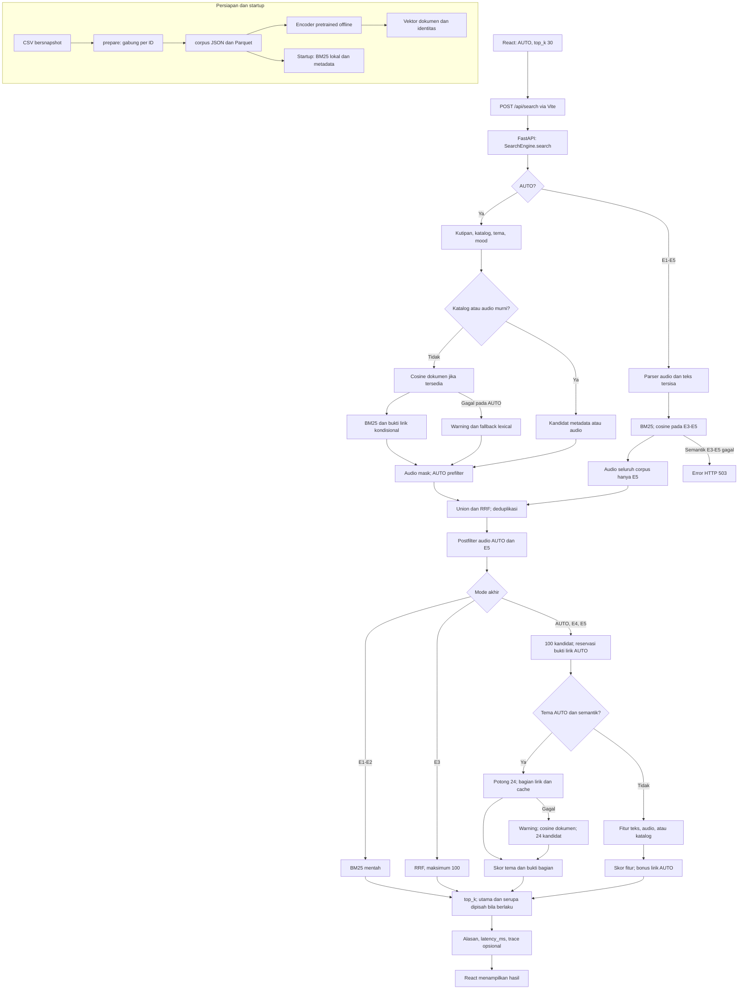

# FAKTA PROYEK MUSIC IR

Audit dimulai **22 November 2026, 16:25:21 WIB (Asia/Jakarta)**. Paket disusun pada 2026-11-22T16:50:25.109685+07:00. Snapshot Git `d1fa4edf10189dbda73eda292b6e795238af2c7f`; root `D:\CODINGGG\Music IR`. Ini paket fakta untuk diperiksa sebelum penyusunan ulang laporan UAS, bukan Bab 1–5.

Empat status digunakan secara terpisah: **EKSEKUSI** (terverifikasi saat audit), **KODE** (ada tetapi belum dijalankan pada jalur terkait), **HISTORIS** (artefak lama), **BELUM TERVERIFIKASI** (data/akses tidak cukup). Ledger [claims.json](evidence/claims.json) memuat status, prosedur, referensi kode, snapshot, dan file bukti setiap klaim utama. Referensi `music_ir/...:baris` merujuk salinan di `evidence/source/`.

## 1. Ringkasan proyek dalam bahasa sederhana

Music IR melayani pengguna yang ingin menemukan lagu dalam koleksi tetap berdasarkan judul, artis/kolaborasi, potongan lirik, tema/suasana, label genre playlist, atau kondisi angka audio. Input berupa teks dan pilihan mode/mood. Output berupa daftar lagu dengan ID, judul, artis, album, genre playlist, angka audio, skor, cuplikan, dan alasan kecocokan. Jalur lirik/tema tertentu memisahkan hasil utama dari hasil serupa; keduanya berbagi batas hasil. [CLM-002/010/019]

Fitur audio berarti **angka dalam dataset**, misalnya tempo, energy, valence, danceability, dan acousticness. Pipeline pencarian tidak mendengarkan rekaman, menerima unggahan audio, atau mengekstrak ciri sinyal. Spotify embed di UI merupakan pemutaran eksternal; ketersediaan audio di Spotify tidak diuji sebagai bagian retrieval.

BM25 mencari kecocokan kata. Embedding BGE-M3 merepresentasikan teks dan mencari kedekatan makna melalui cosine. Aturan kecil mengenali metadata, kutipan, suasana dan batas numerik; RRF menggabungkan kandidat, kemudian reranking menggunakan fitur/skor sesuai jalur. Tidak ditemukan LLM generatif, cross-encoder, pelatihan ulang encoder, atau model rekomendasi personal di jalur aktif yang ditelusuri. Favorit/playlist menggunakan penyimpanan browser, bukan model personalisasi. Agent coding yang mengembangkan program bukan algoritme runtime aplikasi. [CLM-002/004/005; kode engine.py, semantic.py, frontend/src/lib.ts]

## 2. Snapshot kode, konfigurasi aktif, dan lingkungan runtime

Git awal bersih sebelum folder audit dibuat. Hash SHA-256 berkas awal tersedia di [snapshot_before.json](evidence/snapshot_before.json); pemeriksaan akhir ada di [snapshot_after.json](evidence/snapshot_after.json). Tidak dilakukan perbaikan aplikasi, tuning, penggantian corpus, atau perubahan parameter. Build frontend dan cache normal aplikasi dapat menghasilkan artefak; itu dibedakan dari perubahan kode/data. [CLM-001]

Konfigurasi efektif diamati dari instance engine di proses API dan cocok dengan `load_config()` serta file konfigurasi. Lihat [config_snapshot.json](config_snapshot.json) dan [runtime_engine.json](evidence/runtime_engine.json). Backend runtime **LocalBM 25 / local**, bukan Elasticsearch. Variabel proses `MUSIC_IR_BACKEND`, `MUSIC_IR_API`, dan `MUSIC_IR_TEST_ES` tidak disetel pada snapshot. Probe awal port 8000/8501/9200 menolak koneksi; API/UI kemudian dijalankan untuk audit, tanpa mengunduh atau membangun Elasticsearch. [CLM-004/005/018]

Parameter efektif: field_weights=`[3,2,1]`; text_weights=`[0.25,0.25,0.25,0.25,0]`; audio_weight=`0.5`; candidate_limit=`100`; RRF constant=`60`; BM25 k1=`1.2`, b=`0.75`; tema candidate_limit=`24`, document_weight=`0.4`; mood default=`both`, sad valence≤`0.5` dan energy≤`0.65`, happy valence≥`0.5`; tuned=`false`. Trace masing-masing request juga menyertakan config dan identitas corpus/implementasi.

Command launcher repository: `.\run.ps1 api` menjalankan `.venv\Scripts\python.exe -m uvicorn music_ir.api:app --host 127.0.0.1 --port 8000 --reload --reload-dir music_ir`; UI `.\run.ps1 ui` → `npm --prefix frontend run dev` (Vite 127.0.0.1:8501). Build memakai `npm run build` dari frontend; evaluasi CLI tersedia melalui `python -m music_ir evaluate --queries <approved.jsonl> --qrels <human.csv> --output <run> --modes E1 E2 E3 E4 E5 AUTO --backend local --split test --repeats 5`. Command terakhir ini **tidak** dijalankan pada data penelitian karena belum ada qrels layak. Validasi input evaluasi nyata tetap dijalankan dan penolakannya disimpan di [evaluation_eligibility_check.json](evidence/evaluation_eligibility_check.json).

Audit API pertama memakai command uvicorn yang sama tanpa autoreload. Untuk mengamati device/dtype/config dari proses yang benar-benar melayani request, proses kedua membungkus app asli lewat `audit_live_api.py` dengan endpoint baca `/_audit/runtime`; fungsi search dan parameter tetap asli. Command/PID/log ada di `api_service.json`, `api_observed_service.json`, dan file log pasangannya. UI nyata memanggil `/api/search`, diteruskan Vite ke `/search`. Default UI=`AUTO`, top_k UI=`30`; default schema API top_k=`10`. Perbedaan ini dikonfirmasi dari payload browser. [CLM-002]

Engine berjalan sebagai Python native **Windows-11-10.0.26200-SP0**, executable `D:\CODINGGG\Music IR\.venv\Scripts\python.exe`, bukan WSL/container. CPU teramati `11th Gen Intel(R) Core(TM) i5-11400H @ 2.70GHz`, logical CPU=12; RAM yang dilaporkan OS=16,931,676,160 byte (15.77 GiB). Saat snapshot, RAM tersedia 1,259,741,184 byte; beban mesin lain tidak dikontrol. Jumlah core fisik serta inventaris GPU/VRAM hardware **null**: akses CIM ditolak. Torch build `2.15.0+cpu` bersifat CPU, CUDA tidak tersedia di runtime ini; ini tidak membuktikan mesin tidak memiliki GPU. Inferensi nyata device=`cpu`, dtype=`torch.float32`, threads Torch=`4`, batas encoder=`8192`. [CLM-001/004]

Python `3.14.4`, Node `v24.15.0`, npm `11.12.1`; paket proyek `music-ir` versi 0.2.0, frontend `music-ir-ui`1.0.0. Versi terpasang dibaca dari lingkungan, versi lock dari lockfile, dan rentang deklarasi dari pyproject/package.json:

| Paket backend/model | Terpasang | Lockfile | Deklarasi |
| --- | --- | --- | --- |
| numpy | 2.5.4 | 2.5.4 | >=1.26,<3 |
| pandas | 3.1.1 | 3.1.1 | >=2.2,<4 |
| pyarrow | 26.0.1 | 26.0.1 | >=15 |
| fastapi | 0.162.2 | 0.162.2 | >=0.115,<1 |
| uvicorn | 0.54.0 | 0.54.0 | >=0.30,<1 |
| sentence-transformers | 5.7.0 | 5.7.0 | >=3,<6 (semantic) |
| torch | 2.15.0 | 2.15.0 | transitif; tidak dideklarasikan langsung |
| transformers | 5.22.2 | 5.22.2 | transitif; tidak dideklarasikan langsung |
| tokenizers | 0.23.3 | 0.23.3 | transitif; tidak dideklarasikan langsung |
| huggingface-hub | None | 2.4.0 | transitif; tidak dideklarasikan langsung |
| filelock | 4.2.9 | 4.2.9 | >=3,<5 (semantic) |
| httpx | 0.28.1 | 0.28.1 | >=0.27,<1 (test) |

| Paket frontend | Terpasang | Lockfile | Deklarasi |
| --- | --- | --- | --- |
| react | 19.3.1 | 19.3.1 | 19.3.1 |
| react-dom | 19.3.1 | 19.3.1 | 19.3.1 |
| lucide-react | 1.73.0 | 1.73.0 | 1.73.0 |
| @types/node | 24.19.2 | 24.19.2 | ^24.0.0 |
| @playwright/test | 1.65.1 | 1.65.1 | 1.65.1 |
| @types/react | 19.3.0 | 19.3.0 | 19.3.0 |
| @types/react-dom | 19.3.0 | 19.3.0 | 19.3.0 |
| @vitejs/plugin-react | 6.3.0 | 6.3.0 | 6.3.0 |
| typescript | 7.0.2 | 7.0.2 | 7.0.2 |
| vite | 8.3.8 | 8.3.8 | 8.3.8 |

Rincian seluruh paket dan kecocokan lock ada di [runtime.json](evidence/runtime.json), [dependency_comparison.json](evidence/dependency_comparison.json). Lockfile bukan bukti paket terpasang; kedua sumber dibaca terpisah. Berkas `.env`, token, credential, weights, dan dependency trees tidak disertakan.

## 3. Dataset serta hasil audit aktual

Sumber yang cocok dengan SHA audit persiapan adalah `data/raw/67d82c39457bc00a38ea384e5a330404e1d39714ccb06fe19d1facf8963d54e1.csv`. SHA sumber=`67d82c39457bc00a38ea384e5a330404e1d39714ccb06fe19d1facf8963d54e1`; identitas corpus terkanonisasi=`2708d05f6486650d00bec7db689c2672b61829952f8a9b22ec2c3c9755402758`. SHA byte file corpus berbeda dari hash logis corpus; keduanya ada pada snapshot. Sumber berisi **1686 baris × 30 kolom**, **1437 ID unik**. ID kosong/tidak sesuai pola 22 karakter alfanumerik: 0/0. Pola valid bukan verifikasi rekaman di layanan eksternal. [CLM-003]

Duplikasi baris identik: **0** kemunculan tambahan, 0 kelompok. Duplikasi ID: **249** kemunculan tambahan dari **213** kelompok ID berulang. Jadi pengurangan baris menjadi lagu unik bukan berarti 249 baris identik. Penggabungan `prepare()` diulangi ke direktori scratch audit dan seluruh objek dokumen cocok dengan corpus aktif. Field nonplaylist memilih nilai pertama yang tidak kosong, konflik dicatat; field playlist (`playlist_id/name/genre/subgenre`) di-union, dinormalisasi dan diurutkan. Konversi numerik tak valid/nonfinite menjadi None. Konflik nonplaylist terhitung **0** pada sumber ini; dokumen akhir **1437**. Corpus asli tidak ditulis ulang.

Ada **1404/1437 lagu unik dengan lirik (97.70%)**, 33 tanpa lirik, dan 2 lirik nonkosong dengan panjang setelah strip <100 karakter. ID lirik pendek dan audit lengkap tersedia di [data_audit.json](evidence/data_audit.json). Angka historis 1.686/1.437/1.404 cocok dengan hitungan ulang; angka tersebut tidak hanya disalin dari README. Semua `lyrics_match_status` pada corpus tetap `unknown`; kualitas pasangan lirik–rekaman belum dinilai.

Field judul/artis/lirik dipakai untuk retrieval teks. Album/release date/duration/ID digunakan dalam keluaran. Label genre berasal dari **playlist_genre**, dapat lebih dari satu per lagu; **143 lagu** memiliki beberapa label. Jumlah label per genre tersedia di JSON dan tidak boleh dijumlahkan sebagai jumlah lagu unik. Popularitas CSV dipakai untuk tie-break jalur tertentu, bukan popularitas terkini. Field playlist lain dipertahankan pada corpus, bukan otomatis menjadi field BM25.

| Fitur | Tipe aktif | Hilang | Rentang aktual | Satuan/kontrak | Pemakaian |
| --- | --- | --- | --- | --- | --- |
| energy | float | 0 | 0.00161 … 0.99 | nilai dataset 0–1 | filter/preferensi/skor |
| tempo | float | 0 | 49.305 … 209.688 | BPM menurut kontrak parser | filter/preferensi/skor |
| danceability | float | 0 | 0.136 … 0.979 | nilai dataset 0–1 | filter/preferensi/skor |
| loudness | float | 0 | -43.643 … 1.295 | skala dataset; tidak ditransformasi | disimpan, tidak masuk ranking aktif |
| liveness | float | 0 | 0.021 … 0.95 | nilai dataset 0–1 | disimpan, tidak masuk ranking aktif |
| valence | float | 0 | 0.0348 … 0.978 | nilai dataset 0–1 | filter/preferensi/skor |
| speechiness | float | 0 | 0.0232 … 0.848 | nilai dataset 0–1 | disimpan, tidak masuk ranking aktif |
| track_popularity | float | 0 | 68.0 … 100.0 | skala dataset; tidak ditransformasi | tie-break katalog/audio AUTO |
| instrumentalness | float | 0 | 0.0 … 0.971 | nilai dataset 0–1 | disimpan, tidak masuk ranking aktif |
| mode | float | 0 | 0.0 … 1.0 | skala dataset; tidak ditransformasi | disimpan, tidak masuk ranking aktif |
| key | float | 0 | 0.0 … 11.0 | skala dataset; tidak ditransformasi | disimpan, tidak masuk ranking aktif |
| duration_ms | float | 0 | 61673.0 … 547107.0 | ms menurut nama field | tampilan durasi |
| acousticness | float | 0 | 1.33e-05 … 0.995 | nilai dataset 0–1 | filter/preferensi/skor |
| time_signature | float | 0 | 1.0 … 5.0 | skala dataset; tidak ditransformasi | disimpan, tidak masuk ranking aktif |

Rentang angka dihitung ulang; satuan audio selain kontrak parser/nama field tidak memiliki data dictionary asal yang dapat dibuktikan. Tidak ditemukan bukti metode pengambilan metadata/lirik, tanggal pengambilan, verifikasi lisensi sumber lirik, atau validasi pasangan tiap rekaman. Link/URI Spotify dan nama file saja tidak membuktikan asal atau mutu lirik. Audit hanya menetapkan lineage berkas dari SHA ke corpus hasil merge.

## 4. Pipeline offline dan online, diagram, serta tabel tahapan

Alur ringkas: corpus disiapkan dan embedding dokumen tersedia sebelumnya; startup membuat indeks lokal; request UI diparse menjadi intent; mode memilih sumber kandidat yang sesuai; kandidat digabung/difilter; skor dan tie-break ditentukan; UI menampilkan hasil serta alasan. Tahap dalam satu `SearchEngine.search` berjalan **berurutan**, bukan retrieval multijalur konkuren. Model memakai RLock; server dapat menangani request melalui handler sync/threadpool, tetapi itu tidak membuat sumber satu query berjalan paralel.

| Tahap | Fungsi/tugas | Input | Proses/metode aktual | Output | Aktif pada kondisi apa | Lokasi kode dan bukti run |
| --- | --- | --- | --- | --- | --- | --- |
| Offline: gabung | prepare | CSV bersnapshot | Group ID; first nonempty; union playlist; numerik float/None | JSON/Parquet + audit | Saat prepare; audit direplikasi ke scratch | data.py:29; CLM-003 |
| Offline: embedding | _build_embeddings | Judul, artis, lirik | Encoder pretrained; chunk >8192; mean dan normalisasi | vectors.npy + metadata | Build historis; tokenisasi diperiksa ulang | semantic.py:55; CLM-004/014/021 |
| Startup | SearchEngine.__init__ | Corpus JSON/config | BM25 3 field+combined; metadata index; cek matriks/cache identity | Engine siap; model lazy | Setiap proses API | engine.py:51; CLM-004/005 |
| UI/API | api + SearchRequest | query, mode, top_k, mood_basis | Vite /api → FastAPI; validasi; handler sync | search(query,mode,...) | Semua pencarian | App.tsx:97; api.py:114; CLM-002 |
| Rencana query | plan_query/parse/apply_mood | Teks dan metadata corpus | NFKC; lindungi kutipan; parser audio; katalog; tema/mood | Intent, QueryPlan, constraints/preferences | Plan katalog/lirik/tema hanya AUTO; parse audio semua mode | query.py:45; audio.py:23; engine.py:83; trace |
| Semantik | warmup/scores | semantic_text dan vektor dokumen | Load model lokal bila perlu; normalized query; dot seluruh corpus | cosine N elemen | Teks nonkatalog AUTO/E3–E5; gagal AUTO → fallback | semantic.py:149; engine.py:137; CLM-004/017 |
| Lexical/lirik | LocalBM 25.scores/LyricIndex.match | intent.text | BM25; bukti jendela lirik independen kondisional | BM25 N elemen + match dict | Lexical jika teks nonkatalog; match lirik AUTO kecuali semantic/artist/genre | lexical.py:28; lyrics.py:90; CLM-005/010 |
| Mask/skor audio | audio_scores | Seluruh docs, Intent | Irisan batas; sort distribusi per query untuk persentil; metadata mask | mask + audio N elemen | Dihitung setiap search; hanya dipakai AUTO/E5 saat intent aktif | audio.py:66; engine.py:163; trace |
| Kandidat | ranked dan sumber | BM25/cosine/match/audio/metadata | AUTO mask sebelum top; tiap sumber top 100 kecuali list lirik; audio seluruh corpus | Daftar sumber berurutan | Tergantung jalur; bukan semua sumber selalu aktif | engine.py:166; CLM-006/010 |
| Union/fusion | search loop RRF | Daftar sumber | Set indeks untuk dedup; rank 1; 1/(60+r); postfilter audio | Union; lalu <=100 kandidat | E1/E2 mengambil list BM25; lainnya RRF; reservasi lirik AUTO | engine.py:190; CLM-007 |
| Bagian tema | passage_scores | 24 kandidat, semantic_query | Chunk 160 kata overlap 40; cache SQLite; max/top 3, contrast jika profil | Bukti bagian dan ranking cosine | AUTO semantic + semantik tersedia; clip 24 sebelum passage | engine.py:217; passages.py:45; trace REG-03/05/08 |
| Skor akhir | reranking | Fitur/metadata/tema/audio/bonus | Rumus sesuai jalur; tie score lalu popularity atau RRF lalu ID | Kandidat terurut | AUTO/E4/E5; E1/E2 BM25; E3 RRF | engine.py:237; CLM-007 |
| Tampilan | format hasil/diagnostics | Kandidat dan top_k | Utama/serupa berbagi kuota; alasan; snippet; latency sebelum diagnostics | JSON results, related_results, optional trace | Semua mode; pemisahan khusus lirik/tema AUTO | engine.py:277; diagnostics.py:20; CLM-002/019 |

BM25 lokal dibangun saat constructor/startup, tidak dibaca dari indeks Lucene offline. Distribusi fitur audio dihitung/disortir di `audio_scores()` setiap request preferensi, bukan distribusi persisten offline. Pencarian semantik terjadi sebelum BM25 dalam jalur online; kondisi mask diberlakukan saat memilih daftar sumber AUTO, bukan sebelum menghitung seluruh vektor cosine/BM25. Ini membedakan urutan komputasi dari ruang kandidat yang diizinkan.

Sumber diagram: [pipeline_actual.mmd](pipeline_actual.mmd). `pipeline_actual.png` **tidak dihasilkan**: probe tidak menemukan Mermaid module/CLI maupun system mmdc/dot; tidak diunduh renderer baru. Diagram di atas dapat dirender oleh pembaca Markdown yang mendukung Mermaid. Tidak ada screenshot UI yang digambar ulang.

Contoh trace: REG-01 `bruno mars` → artist metadata, tanpa cosine; REG-07 `when i see your face` → bukti lirik, BM25+cosine, bonus exact 4, utama/serupa terpisah; REG-03 `lagu bermakna cinta` → query expansion romance, 24 kandidat, bagian lirik dan tema pembanding; AUDIO `tempo >120 BPM` → audio seluruh corpus, skor kelayakan 1, popularitas untuk tie. Semua berada di [search_traces.jsonl](evidence/search_traces.jsonl) dengan `case_id`, payload, respons, urutan ID, sumber, filter, dan kontribusi.

## 5. Metode, parameter, rumus skor, dan contoh perhitungan yang diverifikasi

**BM25 lokal.** Token=`re.findall(r"\w+", NFKC(text).casefold())`; tidak ada stemming/stopword list. Token query diperlakukan sebagai set. Untuk setiap field, `idf(t)=ln(1+(N-df(t)+0.5)/(df(t)+0.5))`; skor token=`idf × tf × (k1+1)/(tf+k1×(1-b+b×dl/avgdl))`. avgdl menjadi 1 jika rata-rata panjang nol. E1 memakai satu field gabungan judul+artis+lirik. E2–E5/jalur teks AUTO menjumlahkan `3×BM25judul + 2×BM25artis + 1×BM25lirik`; bukan BM25F dengan satu normalisasi panjang bersama. BM25 retrieval hanya memasukkan skor positif. Adapter Elasticsearch memakai standard tokenizer+lowercase dan Lucene BM25 dengan boost field, tetapi **tidak dijalankan**; kesetaraan kedua analyzer tidak diasumsikan. [CLM-005/018; lexical.py:28]

**Semantik dokumen.** Model ID=`BAAI/bge-m3`, revision=`5617a9f61b028005a4858fdac845db406aefb181`; cache lokal untuk revision ini ditemukan dan loader online meminta revision tersebut dengan local_files_only=True. Serialisasi persis `Judul: <track_name>\nArtis: <track_artist>\nLirik: <lyrics>`; tanpa genre/audio. Matriks `[1437, 1024]` berdimensi 1024, float32, finite; norm baris min=0.9999998808, max=1.0000001192. Hash corpus dan urutan 1437 ID cocok. Exact search menggunakan `clip(vectors @ normalized_query,-1,1)` atas seluruh corpus; tidak ada indeks ANN. Encoder pretrained digunakan **tanpa pelatihan ulang**; membuat embedding adalah inferensi. [CLM-004]

Batas dokumen 8192 token termasuk special tokens. Kode untuk dokumen lebih panjang: potongan 512 token dengan stride 448 (overlap 64); encode setiap potongan, rata-rata vektor per pemilik, normalisasi lagi. Metadata historis menyebut 0 dokumen di-chunk. Audit tokenizer pinned atas seluruh 1437 dokumen menemukan max 2217 token konten +2 special tokens, dan 0 melewati batas; ini memverifikasi kebutuhan chunking corpus sekarang, tanpa membangun ulang embedding. Metadata build historis mencatat batch 4, CPU, 3267.37 detik; durasi itu **HISTORIS**, bukan pengukuran ulang audit. [CLM-014/021]

**Audio.** Batas eksplisit mendukung >,<,≥,≤,= dan negasi operator (termasuk != hasil negasi); tempo nonnegatif dalam BPM, empat fitur lain 0–1. Semua batas diiriskan; nilai tidak ada/nonfinite gagal batas, termasuk !=. Jika hanya batas tanpa preferensi, audio score=1 untuk ranking kandidat lolos; itu indikator, bukan peluang relevansi. Preferensi tinggi/rendah eksplisit tersedia untuk tempo/energy; mood audio menambahkan valence/energy secara internal. Untuk nilai v di distribusi seluruh corpus berukuran n, `p=(left(v)+right(v)-1)/(2(n-1))` dengan posisi searchsorted 0-based; nilai seri mendapat midrank. Tinggi=p, rendah=1-p; beberapa preferensi dirata-ratakan. Nilai hilang atau distribusi konstan/n≤1 diberi 0.5. Distribusi tidak dibatasi hanya dokumen lolos. Jalur audio membuat kandidat independen dari seluruh corpus, bukan sekadar menyaring teks. [audio.py:66; CLM-010/007]

**Fusion.** RRF=`Σ sumber 1/(60+rank)` dengan rank dimulai 1. BM25/cosine/metadata/audio umumnya top 100; sumber lirik AUTO tidak dipotong 100 sebelum union. Union set indeks menghapus duplikasi. AUTO menyeleksi source text/semantic dengan mask audio/metadata sebelum top; AUTO/E5 juga membuang pelanggar audio sesudah union. Kandidat RRF kemudian dipotong 100 dengan tie ID. Bukti lirik AUTO dicadangkan: exact dahulu, similarity turun, RRF turun, ID; sisa anggaran diisi kandidat nonmatch. E1/E2 memakai daftar BM25 langsung; E3 memakai RRF akhir. RRF bukan fitur numerik yang dijumlahkan ke skor rerank E4/E5/AUTO, tetapi masih menjadi tie-break pada jalur umum.

**Reranking teks.** Di kandidat akhir, B=(BM25-min)/(max-min), atau 0 jika span 0; C=(cosine+1)/2; T/A adalah max(exact normalized equality, Jaccard set token query vs judul/artis); P=1 jika frasa query ≥2 token muncul berurutan dalam lirik. `text=0.25B+0.25C+0.25T+0.25A+0P`. Tanpa audio, final=text. Dengan teks+audio pada AUTO/E5, `final=0.5text+0.5audio`; audio murni memakai weight 1. Katalog AUTO mengganti text dengan similarity metadata. Tema AUTO mengganti skor fitur umum dengan skor semantik tema. Jadi bobot fitur umum tidak selalu aktif pada setiap query.

**Katalog dan lirik.** Judul exact menggunakan token key. Artis memakai rentang kredit berurutan yang dipisah koma agar kolaborasi/nama berkoma dapat cocok; tidak ada ID anggota artis, sehingga ambiguitas kredit tetap ada. Fuzzy judul multikata: SequenceMatcher ratio≥0.75, ≥3 kata unik bersama, ≤1 edit kata; pilih similarity terbaik. Bukti lirik exact dapat mengalahkan tebakan judul approximate pada teks tanpa awalan judul. Genre exact mengikuti label playlist. Lirik punya tokenizer apostrof/kontraksi sendiri, berbeda dari BM25: exact perlu≥3 token dan≥2 unik. Jika exact ada, fuzzy tidak dicari. Fuzzy hanya 4–32 token dan≥3 unik, dukungan≥max(3,ceil(0.6×unik)), maksimal 200 lagu diperiksa; anggaran 1 edit token untuk panjang≤6 atau 2 untuk lebih panjang, similarity≥0.76. Biaya substitusi typo karakter/transposisi yang memenuhi syarat pada kata panjang≥4 adalah 0.35; selain itu edit 1. Window dicari di sekitar longest-match anchor, bukan pencarian global edit-distance semua posisi. [metadata.py:30; lyrics.py:90]

Bonus lirik AUTO sesudah skor dasar: exact+4, approximate+2×similarity. Skor exact dapat melebihi 1 (batas teoritis skor dasar+bonus dapat mencapai 5); bukan probabilitas. Katalog exact dan audio hard-only dapat bernilai 1 seragam; urutan AUTO untuk kondisi tersebut mengutamakan popularitas CSV lalu ID. Jalur umum rerank memakai skor turun, RRF turun, ID naik. E1/E2 memakai BM25 turun lalu ID; E3 RRF turun lalu ID. E5 audio hard-only mempertahankan pemilihan/tie berbasis RRF/ID sehingga urutannya berbeda dari AUTO.

**Tema/mood dan cache.** Query bertema/mood diubah oleh aturan eksplisit, misalnya deskripsi happiness/sadness; cinta dan sulit move on memiliki profil pembanding tetap. Maksimal 24 kandidat tema dinilai lewat bagian lirik 160 kata dengan overlap 40 (stride 120); bagian identik didedup di per-dokumen chunk dan vektor dapat digunakan ulang antar-dokumen. Pooling=`0.7×bagian terbaik+0.3×mean top3`; jika profil contrast, nilai bagian ranking=`(cosine tema-max cosine pembanding)/2`, pooling di urutan nilai ranking. Skor akhir tema=`0.4×(cosine dokumen+1)/2 +0.6×(ranking cosine bagian+1)/2` jika ada bukti, jika tidak memakai cosine dokumen saja. Profil moving_on memerlukan loss cue pada **seluruh lirik** agar masuk utama; lainnya dapat masuk serupa. Nilai valence/energy untuk mood adalah proksi yang dapat dipilih lyrics/audio/both, bukan label emosi yang tervalidasi. [query.py:33; passages.py:45; mood.py:7]

Cache dokumen: `artifacts/semantic/vectors.npy`+metadata, diperiksa corpus hash, model/revision, urutan ID, shape, finite, dan norm. Model dimuat lazy ke memori proses. Cache bagian: `passages.sqlite3`; key SHA 256 dari nama/revision model, versi `lyric-passages-v1`, separatorNUL, dan teks bagian. Perubahan teks/model membuat key baru; vektor lama tidak dihapus. Cache miss mengenkode bagian batch 4, cache hit menggunakan vektor; query dan tema pembanding tetap dienkode setiap request. Tidak ditemukan response/query-result cache yang mengembalikan ranking lama tanpa pencarian ulang.

**Fallback.** AUTO tanpa semantik siap/berhasil mengirim warning, menonaktifkan fitur cosine dan bobotnya, lalu menormalisasi ulang bobot teks lain (konfigurasi ini menjadi 1/3 masing-masing untuk B/T/A; P0). Jika semua bobot tersisa 0, fallback BM25 dipakai. Katalog/audio murni tidak memerlukan encoder dan bukan degradasi. E3–E5 gagal saat semantik yang dibutuhkan tidak tersedia; E1/E2 tidak membutuhkannya. Kegagalan bagian lirik mempertahankan cosine dokumen, warning dan degraded; kandidat sudah dibatasi 24. Gangguan sengaja diuji lewat fixture unit, bukan merusak cache/model produksi. [CLM-017]

**Status parameter.** Nilai yang berjalan konsisten dengan config `tuned=false`. Tidak ditemukan artefak trials tuning dan tidak ada qrels berlabel; tidak ada dasar menyebut bobot optimal/tuned pada development set manusia. Fungsi `tune()` tersedia (**KODE** untuk data penelitian), tetapi tidak dijalankan audit. Kasus pada skrip regresi jelas diperlakukan sebagai pengembangan/regresi; riwayat lengkap pemilihan aturan/bobot sebelumnya tidak tersedia. [CLM-020/022]

**Perhitungan angka.** Semua 2.790 kandidat trace yang memiliki final rank diperiksa jumlah kontribusinya dan RRF dari source ranks (toleransi 1e-8), lulus; selisih maksimum jumlah kontribusi=1.11e-16. Delapan contoh berikut juga dihitung ulang secara terpisah dari raw BM25/cosine/definisi fitur/distribusi audio; BM25 satu contoh dihitung langsung dari token corpus. Toleransi independen 1e-7, semuanya lulus. Angka lengkap ada di [score_independent_examples.json](evidence/score_independent_examples.json) dan [score_verification.json](evidence/score_verification.json). Ini verifikasi aritmetika, bukan relevansi. [CLM-007]

| Case | Track ID | Seluruh kontribusi | Hitung independen | Skor respons | Selisih |
| --- | --- | --- | --- | --- | --- |
| REG-03 | 6 nGeLlakfzlBcFdZXteDq 7 | semantic_theme=0.323707747459 + lyric_passage=0.316587451212 + audio=0 + lyric_bonus=0 | 0.640295198672 | 0.640295198672 | 0 |
| REG-07 | 7 BqBn 9 nzAq 8 spo 5e7 cZ0 dJ | bm25_normalized=0.0456432239474 + cosine_normalized=0.189924091101 + title_overlap=0 + artist_overlap=0 + lyric_phrase=0 + audio=0 + lyric_bonus=4 | 4.2355673225 | 4.23556731505 | 7.45e-09 |
| AUDIO | 2 plbrEY 59 IikOBgBGLjaoe | audio=1 + lyric_bonus=0 | 1 | 1 | 0 |
| PREF | 6 KzdWw 8 Hi1 bz1 lVw 2 AXDzb | audio=1 + lyric_bonus=0 | 1 | 1 | 0 |
| MIXTEXT | 4 cktbXiXOapiLBMprHFErI | bm25_normalized=0.125 + cosine_normalized=0.0943641960621 + title_overlap=0.0625 + artist_overlap=0 + lyric_phrase=0 + audio=0.472318941504 + lyric_bonus=0 | 0.754183137566 | 0.754183137566 | 0 |
| MODE-0-E2 | 6 uBhi 9 gBXWjanegOb 2 Phh 0 | bm25_raw=26.9247657377 | 26.9247657377 | 26.9247657377 | 0 |
| MODE-0-E3 | 6 uBhi 9 gBXWjanegOb 2 Phh 0 | rrf=0.0327868852459 | 0.0327868852459 | 0.0327868852459 | 0 |
| MODE-0-E4 | 6 uBhi 9 gBXWjanegOb 2 Phh 0 | bm25_normalized=0.25 + cosine_normalized=0.200562179089 + title_overlap=0.25 + artist_overlap=0 + lyric_phrase=0 + audio=0 + lyric_bonus=0 | 0.700562171638 | 0.700562179089 | 7.45e-09 |

## 6. Perbedaan AUTO dan konfigurasi eksperimen

| Mode | Entry/config | Retrieval aktif | Posisi filter | Fusion | Reranking | Kebijakan tambahan | Status eksekusi |
| --- | --- | --- | --- | --- | --- | --- | --- |
| AUTO | API/UI default; config aktif | Katalog ATAU teks BM25+cosine; lirik/tema kondisional; audio bila aktif | Metadata/audio sebelum top; audio juga sesudah union | RRF kandidat, bukan skor akhir | Fitur, katalog, atau tema+bagian; bonus lirik | Mood, reservasi lirik, populer untuk tie tertentu, fallback | HTTP nyata + UI; CLM-002/010 |
| E1 | search(mode=E1) | BM25 satu teks combined; audio tidak dipakai | Tidak ada filter audio aktif | Tidak untuk urutan final | Tidak | Query audio tetap diparse/dihapus; pure audio kosong | HTTP nyata |
| E2 | search(mode=E2) | Jumlah BM25 field berbobot 3:2:1 | Tidak ada filter audio aktif | Tidak untuk urutan final | Tidak | Tie ID; tanpa aturan AUTO | HTTP nyata |
| E3 | search(mode=E3) | BM25 field + cosine dokumen | Tidak ada filter audio aktif | RRF dua sumber; top 100 | Tidak | Tanpa fallback; tie ID | HTTP nyata |
| E4 | search(mode=E4) | Sama E3 | Tidak ada filter audio aktif | Sama E3 | Lima fitur berbobot; tanpa bonus AUTO | Tie RRF lalu ID; tanpa fallback | HTTP nyata |
| E5 | search(mode=E5) | Sama E4 + audio corpus penuh jika intent aktif | Sesudah union, sebelum cap akhir | Teks+semantik+audio | Teks/audio weight 0.5 jika mixed; audio weight 1 jika pure | Tanpa katalog/lirik/tema/mood AUTO; tie RRF lalu ID | HTTP nyata |

Pencarian biasa memakai AUTO. AUTO **bukan** sinonim E5: routing metadata, proteksi kutipan, query expansion/mood, pencocokan/bonus/reservasi lirik, passage reranking, pemisahan utama/serupa, popularitas tie, dan fallback merupakan kebijakan tambahan. Perbandingan nyata pada `Stay`, `I just woke up from a dream`, mixed rendah energy, dan audio>120 ada di [mode_comparisons.json](evidence/mode_comparisons.json): E3/E4 memiliki set ID kandidat sama pada 4/4 probe; urutan akhirnya boleh berubah. E4/E5 identik pada dua probe tanpa audio; berbeda pada dua dengan audio. AUTO/E5 berbeda pada katalog, kutipan, dan hard-audio probe. Ini uji sifat pada probe tersebut dan penelusuran kode, bukan teorema untuk semua query. Tidak ada perbandingan efektivitas yang sah. [CLM-006]

## 7. Hasil validasi fungsional dan studi kasus

Backend: `python -m unittest discover -s tests -v`, **93 tests:88 passed,0 failed,5 skipped**, waktu unittest 6.304 detik; log lengkap beserta command/durasi proses di [backend_tests.json](evidence/backend_tests.json). Lima skipped adalah integrasi Elasticsearch, karena MUSIC_IR_TEST_ES tidak 1 dan layanan/indeks belum dijalankan. Banyak tes memakai FakeSemantic/fixture kecil; ini tidak mengukur relevansi model nyata. Fallback dan evaluator diuji lewat fixture. [CLM-008/017/018]

Frontend: build TypeScript+Vite exit 0; **15 tes Playwright passed,0 failed,0 skipped**, waktu reporter 30.1 detik (proses 31.89 detik). Tes tersebut memakai route API tiruan, dibedakan dari live smoke browser. Log: [frontend_build.json](evidence/frontend_build.json), [frontend_tests.json](evidence/frontend_tests.json). Smoke browser tambahan tanpa mock berhasil menghasilkan 4 screenshot dan tidak merekam pageerror. [CLM-009/019]

Daftar 51 kasus dibekukan di [cases.jsonl](evidence/cases.jsonl) sebelum request. Terdapat 48 respons HTTP 200 dan 3 respons 422 yang memang diharapkan. Pemeriksaan bersama mencakup keunikan ID, batas top_k, dan kepatuhan audio bila aktif; sembilan regresi menjalankan verifier lama; sembilan kelompok assertion tambahan mengecek title/Unicode/no-lyrics/artist/audio/mood/lirik. Label `pass` berarti assertion yang dicatat terpenuhi, bukan judgment relevansi keseluruhan. Fallback live fault injection tidak dilakukan; fixture unit mencakupnya. [CLM-010]

| Case ID | Query/input | Asal kasus | Harapan dan dasar | Mode/backend | Hasil aktual | Status | Bukti |
| --- | --- | --- | --- | --- | --- | --- | --- |
| REG-01 | bruno mars | pengembangan/regresi | existing verify(number,response) functional assertions | AUTO/local | HTTP 200; artist; utama 9, serupa 0 | pass | CLM-010; search_traces.jsonl case_id |
| REG-02 | locked out in heaven | pengembangan/regresi | existing verify(number,response) functional assertions | AUTO/local | HTTP 200; title; utama 1, serupa 0 | pass | CLM-010; search_traces.jsonl case_id |
| REG-03 | lagu bermakna cinta | pengembangan/regresi | existing verify(number,response) functional assertions | AUTO/local | HTTP 200; semantic; utama 24, serupa 0 | pass | CLM-010; search_traces.jsonl case_id |
| REG-04 | rock song | pengembangan/regresi | existing verify(number,response) functional assertions | AUTO/local | HTTP 200; genre; utama 30, serupa 0 | pass | CLM-010; search_traces.jsonl case_id |
| REG-05 | lagu tentang sulit melupakan seseorang | pengembangan/regresi | existing verify(number,response) functional assertions | AUTO/local | HTTP 200; semantic; utama 12, serupa 12 | pass | CLM-010; search_traces.jsonl case_id |
| REG-06 | not like us | pengembangan/regresi | existing verify(number,response) functional assertions | AUTO/local | HTTP 200; title; utama 1, serupa 0 | pass | CLM-010; search_traces.jsonl case_id |
| REG-07 | when i see your face | pengembangan/regresi | existing verify(number,response) functional assertions | AUTO/local | HTTP 200; lyrics; utama 1, serupa 29 | pass | CLM-010; search_traces.jsonl case_id |
| REG-08 | lagu bermakna sedih | pengembangan/regresi | existing verify(number,response) functional assertions | AUTO/local | HTTP 200; semantic; utama 24, serupa 0 | pass | CLM-010; search_traces.jsonl case_id |
| REG-09 | lirik "make the stars look like there not shining" | pengembangan/regresi | existing verify(number,response) functional assertions | AUTO/local | HTTP 200; lyrics; utama 1, serupa 29 | pass | CLM-010; search_traces.jsonl case_id |
| TITLE | Die With A Smile | probe fungsi audit | Exact catalog title | AUTO/local | HTTP 200; title; utama 1, serupa 0 | pass | CLM-010; search_traces.jsonl case_id |
| COLLAB | Lady Gaga | probe fungsi audit | Catalog artist including collaboration | AUTO/local | HTTP 200; artist; utama 5, serupa 0 | pass | CLM-010; search_traces.jsonl case_id |
| LYRIC | lirik "I just woke up from a dream" | probe fungsi audit | Literal contiguous lyric evidence | AUTO/local | HTTP 200; lyrics; utama 1, serupa 29 | pass | CLM-010; search_traces.jsonl case_id |
| AUDIO | tempo > 120 BPM | probe fungsi audit | All displayed tempo >120; indicator 1 | AUTO/local | HTTP 200; audio; utama 30, serupa 0 | pass | CLM-010; search_traces.jsonl case_id |
| PREF | energi rendah | probe fungsi audit | Low-energy midrank percentile preference | AUTO/local | HTTP 200; audio; utama 30, serupa 0 | pass | CLM-010; search_traces.jsonl case_id |
| MULTI | tempo >= 120 BPM dan energi < 0,5 | probe fungsi audit | Intersection of explicit bounds | AUTO/local | HTTP 200; audio; utama 30, serupa 0 | pass | CLM-010; search_traces.jsonl case_id |
| BOUND | tempo = 149.937 BPM | probe fungsi audit | Exact boundary operator | AUTO/local | HTTP 200; audio; utama 1, serupa 0 | pass | CLM-010; search_traces.jsonl case_id |
| MIXED | Bruno Mars dengan tempo > 120 BPM | probe fungsi audit | Artist match AND audio constraint | AUTO/local | HTTP 200; artist; utama 5, serupa 0 | pass | CLM-010; search_traces.jsonl case_id |
| MIXTEXT | leaving memories dengan energi rendah | probe fungsi audit | Text and corpus-wide audio candidate union | AUTO/local | HTTP 200; text; utama 30, serupa 0 | pass | CLM-010; search_traces.jsonl case_id |
| EMPTYRESULT | tempo > 999 BPM | probe fungsi audit | No eligible documents | AUTO/local | HTTP 200; audio; utama 0, serupa 0 | pass | CLM-010; search_traces.jsonl case_id |
| CONTRADICT | tempo > 120 BPM dan tempo < 90 BPM | probe fungsi audit | No eligible documents | AUTO/local | HTTP 200; audio; utama 0, serupa 0 | pass | CLM-010; search_traces.jsonl case_id |
| UNKNOWN | artis qzxnonexistent | probe fungsi audit | Empty catalog artist match | AUTO/local | HTTP 200; artist; utama 0, serupa 0 | pass | CLM-010; search_traces.jsonl case_id |
| UNICODE | Ｄｉｅ With A Smile | probe fungsi audit | NFKC title normalization | AUTO/local | HTTP 200; title; utama 1, serupa 0 | pass | CLM-010; search_traces.jsonl case_id |
| NOLYRICS | Nueva Era | probe fungsi audit | Track without lyrics remains retrievable by title | AUTO/local | HTTP 200; title; utama 1, serupa 0 | pass | CLM-010; search_traces.jsonl case_id |
| EMPTY | (string kosong) | probe fungsi audit | API validation 422 | AUTO/local | HTTP 422; None; utama 0, serupa 0 | pass | CLM-010; search_traces.jsonl case_id |
| WHITESPACE |     | probe fungsi audit | Parser validation 422 | AUTO/local | HTTP 422; None; utama 0, serupa 0 | pass | CLM-010; search_traces.jsonl case_id |
| BADBOUND | energi > 2 | probe fungsi audit | Audio input rejected 422 | AUTO/local | HTTP 422; None; utama 0, serupa 0 | pass | CLM-010; search_traces.jsonl case_id |
| MOODAUDIO | lagu sedih | probe fungsi audit | Audio mood basis, no text encoder | AUTO/local | HTTP 200; audio; utama 30, serupa 0 | pass | CLM-010; search_traces.jsonl case_id |
| MODE-0-E1 | Stay | pengembangan/regresi | same set E3/E4; E4=E5 without audio; different AUTO policy allowed | E1/local | HTTP 200; text; utama 30, serupa 0; kandidat pada trace | pass | CLM-010; search_traces.jsonl case_id |
| MODE-0-E2 | Stay | pengembangan/regresi | same set E3/E4; E4=E5 without audio; different AUTO policy allowed | E2/local | HTTP 200; text; utama 30, serupa 0; kandidat pada trace | pass | CLM-010; search_traces.jsonl case_id |
| MODE-0-E3 | Stay | pengembangan/regresi | same set E3/E4; E4=E5 without audio; different AUTO policy allowed | E3/local | HTTP 200; text; utama 30, serupa 0; kandidat pada trace | pass | CLM-010; search_traces.jsonl case_id |
| MODE-0-E4 | Stay | pengembangan/regresi | same set E3/E4; E4=E5 without audio; different AUTO policy allowed | E4/local | HTTP 200; text; utama 30, serupa 0; kandidat pada trace | pass | CLM-010; search_traces.jsonl case_id |
| MODE-0-E5 | Stay | pengembangan/regresi | same set E3/E4; E4=E5 without audio; different AUTO policy allowed | E5/local | HTTP 200; text; utama 30, serupa 0; kandidat pada trace | pass | CLM-010; search_traces.jsonl case_id |
| MODE-0-AUTO | Stay | pengembangan/regresi | same set E3/E4; E4=E5 without audio; different AUTO policy allowed | AUTO/local | HTTP 200; title; utama 1, serupa 0; kandidat pada trace | pass | CLM-010; search_traces.jsonl case_id |
| MODE-1-E1 | I just woke up from a dream | pengembangan/regresi | same set E3/E4; E4=E5 without audio; different AUTO policy allowed | E1/local | HTTP 200; text; utama 30, serupa 0; kandidat pada trace | pass | CLM-010; search_traces.jsonl case_id |
| MODE-1-E2 | I just woke up from a dream | pengembangan/regresi | same set E3/E4; E4=E5 without audio; different AUTO policy allowed | E2/local | HTTP 200; text; utama 30, serupa 0; kandidat pada trace | pass | CLM-010; search_traces.jsonl case_id |
| MODE-1-E3 | I just woke up from a dream | pengembangan/regresi | same set E3/E4; E4=E5 without audio; different AUTO policy allowed | E3/local | HTTP 200; text; utama 30, serupa 0; kandidat pada trace | pass | CLM-010; search_traces.jsonl case_id |
| MODE-1-E4 | I just woke up from a dream | pengembangan/regresi | same set E3/E4; E4=E5 without audio; different AUTO policy allowed | E4/local | HTTP 200; text; utama 30, serupa 0; kandidat pada trace | pass | CLM-010; search_traces.jsonl case_id |
| MODE-1-E5 | I just woke up from a dream | pengembangan/regresi | same set E3/E4; E4=E5 without audio; different AUTO policy allowed | E5/local | HTTP 200; text; utama 30, serupa 0; kandidat pada trace | pass | CLM-010; search_traces.jsonl case_id |
| MODE-1-AUTO | I just woke up from a dream | pengembangan/regresi | same set E3/E4; E4=E5 without audio; different AUTO policy allowed | AUTO/local | HTTP 200; lyrics; utama 1, serupa 29; kandidat pada trace | pass | CLM-010; search_traces.jsonl case_id |
| MODE-2-E1 | leaving memories dengan energi rendah | pengembangan/regresi | same set E3/E4; E4=E5 without audio; different AUTO policy allowed | E1/local | HTTP 200; text; utama 30, serupa 0; kandidat pada trace | pass | CLM-010; search_traces.jsonl case_id |
| MODE-2-E2 | leaving memories dengan energi rendah | pengembangan/regresi | same set E3/E4; E4=E5 without audio; different AUTO policy allowed | E2/local | HTTP 200; text; utama 30, serupa 0; kandidat pada trace | pass | CLM-010; search_traces.jsonl case_id |
| MODE-2-E3 | leaving memories dengan energi rendah | pengembangan/regresi | same set E3/E4; E4=E5 without audio; different AUTO policy allowed | E3/local | HTTP 200; text; utama 30, serupa 0; kandidat pada trace | pass | CLM-010; search_traces.jsonl case_id |
| MODE-2-E4 | leaving memories dengan energi rendah | pengembangan/regresi | same set E3/E4; E4=E5 without audio; different AUTO policy allowed | E4/local | HTTP 200; text; utama 30, serupa 0; kandidat pada trace | pass | CLM-010; search_traces.jsonl case_id |
| MODE-2-E5 | leaving memories dengan energi rendah | pengembangan/regresi | same set E3/E4; E4=E5 without audio; different AUTO policy allowed | E5/local | HTTP 200; text; utama 30, serupa 0; kandidat pada trace | pass | CLM-010; search_traces.jsonl case_id |
| MODE-2-AUTO | leaving memories dengan energi rendah | pengembangan/regresi | same set E3/E4; E4=E5 without audio; different AUTO policy allowed | AUTO/local | HTTP 200; text; utama 30, serupa 0; kandidat pada trace | pass | CLM-010; search_traces.jsonl case_id |
| MODE-3-E1 | tempo > 120 BPM | pengembangan/regresi | same set E3/E4; E4=E5 without audio; different AUTO policy allowed | E1/local | HTTP 200; audio; utama 0, serupa 0; kandidat pada trace | pass | CLM-010; search_traces.jsonl case_id |
| MODE-3-E2 | tempo > 120 BPM | pengembangan/regresi | same set E3/E4; E4=E5 without audio; different AUTO policy allowed | E2/local | HTTP 200; audio; utama 0, serupa 0; kandidat pada trace | pass | CLM-010; search_traces.jsonl case_id |
| MODE-3-E3 | tempo > 120 BPM | pengembangan/regresi | same set E3/E4; E4=E5 without audio; different AUTO policy allowed | E3/local | HTTP 200; audio; utama 0, serupa 0; kandidat pada trace | pass | CLM-010; search_traces.jsonl case_id |
| MODE-3-E4 | tempo > 120 BPM | pengembangan/regresi | same set E3/E4; E4=E5 without audio; different AUTO policy allowed | E4/local | HTTP 200; audio; utama 0, serupa 0; kandidat pada trace | pass | CLM-010; search_traces.jsonl case_id |
| MODE-3-E5 | tempo > 120 BPM | pengembangan/regresi | same set E3/E4; E4=E5 without audio; different AUTO policy allowed | E5/local | HTTP 200; audio; utama 30, serupa 0; kandidat pada trace | pass | CLM-010; search_traces.jsonl case_id |
| MODE-3-AUTO | tempo > 120 BPM | pengembangan/regresi | same set E3/E4; E4=E5 without audio; different AUTO policy allowed | AUTO/local | HTTP 200; audio; utama 30, serupa 0; kandidat pada trace | pass | CLM-010; search_traces.jsonl case_id |

JSON mentah lengkap mempertahankan hasil utama dan serupa secara terpisah; lihat [search_traces.jsonl](evidence/search_traces.jsonl), [case_results.json](evidence/case_results.json), [case_additional_assertions.json](evidence/case_additional_assertions.json). Screenshot asli: [pencarian](evidence/screenshots/search.png), [trace](evidence/screenshots/trace.png), [hasil kosong](evidence/screenshots/empty.png), [status evaluasi](evidence/screenshots/evaluation_status.png). Payload browser dan respons: [ui_live_responses.json](evidence/ui_live_responses.json). Tidak ada narasi hasil sebelum perbaikan yang dibuat; semua kasus dalam paket ini berasal dari snapshot yang sama.

## 8. Status evaluasi efektivitas retrieval

Status: **BELUM DAPAT DIEVALUASI**. Query aktual 160: title 32, artist 32, lyrics 32, semantic 32, audio 32; setiap kategori 8 dev+24 test, total 40 dev+120 test. Sumber 96 corpus_draft dan 64 authored_draft. Review approved 0, pasangan query–dokumen dinilai 0, query dengan judgment 0, query dengan grade≥2 sebanyak 0, penilai 0, cross-check/adjudikasi 0. Database SQLite diperiksa read-only terhadap identitas dataset aktif `6375261581944be28d6aabf939996fffec8b2ad1270a4a407262a616bfde291e`; qrels.template.csv hanya header (0 baris data). Lima pool historis yang ada bukan judgment. [CLM-011]

group_id berjumlah 64 dan tidak melintasi split; hint track ID juga tidak melintasi split. Pemeriksaan string NFKC/casefold yang mempertahankan operator tidak menemukan duplikasi exact lintas split. Ada tabrakan token-only ketika tandaoperator dibuang (`tempo >120` vs `tempo <=120`); itu **bukan query ekuivalen atau bukti kebocoran**. Query `artist-001`, `lyrics-001`, dan `title-016` juga muncul di regresi aktif; `title-016` berada pada test. Riwayat lengkap penggunaan saat menyusun aturan tidak tersedia, jadi independensi benchmark tidak dapat dinyatakan hanya karena group terpisah. [CLM-022]

Label manusia belum tersedia, sehingga nDCG@10, MRR@10, Recall@100 semuanya **null**, bukan 0. [retrieval_metrics_summary.json](evidence/retrieval_metrics_summary.json) menyimpan alasan. Tidak dihitung metrik proksi sebagai pengganti relevansi. hint/targetID, keluaran model, filter genre/tempo, hasil pilihan agent, dan urutan sistem tidak dijadikan ground truth. [CLM-012]

Evaluator tersedia menggunakan gain `2^grade-1`, discount log 2(rank+1), normalisasi DCG dengan ideal top 10; relevan biner grade≥2. MRR mencari relevan pertama sampai 10; Recall menghitung relevan unik sampai 100 dibagi jumlah relevan diketahui. Unjudged diperlakukan 0 di fungsi metrik, tetapi tetap harus dibedakan dari label manusia 0 pada pengumpulan; recall relatif qrels yang diketahui. Empty ranking memberi 0 jika query memiliki relevan; fungsi metrik juga 0 untuk query tanpa relevan, tetapi validator menolak query wajib tanpa label≥2. Duplikasi/konflik grade dan split diperiksa sesuai `read_benchmark`. Fixture hitungan manual terpisah pada 3 dokumen lulus 1e-12; [evaluator_manual_fixture.json](evidence/evaluator_manual_fixture.json) **bukan hasil dataset penelitian**.

Objek ranking evaluator sekarang adalah `response.results` (**utama saja**), bukan `candidate_ids`, bukan gabungan tampilan; `related_results` tidak dinilai. Pool aplikasi juga utama top-depth ditambah hint dan 2 sampel corpus, tanpa label otomatis. Untuk tema AUTO, daftar kandidat/utama+serupa sudah dibatasi 24, sehingga metrik bernama Recall@100 akan bekerja pada daftar nyata yang mungkin jauh lebih pendek. Jangan membandingkannya dengan recall kandidat 100 seolah objek sama. Evaluator macro mean per mode/kategori tersedia, tetapi tidak dijalankan untuk penelitian. Penanganan error belum menulis incomplete manifest; lihat bagian 10.

Siapan manusia: [annotation_needed.csv](evidence/annotation_needed.csv) berisi **191 pasangan dari 10 query aktual**, union hasil utama top 10 AUTO/E1–E5;60 request pooling berhasil. Urutan diacak, mode/skor/hint disembunyikan, label dan penilai kosong. Semua 191 pasangan **100%unjudged** saat dibuat; angka ini proporsi status anotasi, bukan efektivitas. [query_review_checklist.csv](evidence/query_review_checklist.csv) mencakup 160 query; **150 belum dipool pada audit**. Pedoman dan batas pooling: [ANNOTATION_GUIDE.md](ANNOTATION_GUIDE.md); rencana/pencatatan: [annotation_manifest.json](evidence/annotation_manifest.json), [annotation_pool_traces.jsonl](evidence/annotation_pool_traces.jsonl). [CLM-016]

Pekerjaan manusia berikutnya: setujui maksud query, verifikasi dokumen/lirik yang relevan, perluas pool terutama untuk recall, beri grade 0–3 secara independen, periksa silang/adjudikasi konflik, dokumentasikan asal label, lalu bekukan query/qrels/corpus/config untuk perbandingan seluruh mode. Skala/pedoman saja tidak berarti aktivitas penilaian sudah dilakukan. Keunggulan AUTO/E5 belum dapat disimpulkan.

## 9. Hasil pengukuran waktu dan kondisi cache

Rencana dibekukan sebelum run:6 query(title,artist,lyrics,tema,audio,mixed), semua 6 mode,10 warm-up per mode(**60 total**),5 pengulangan per query-mode(**180 observasi**,30 permode), seed 42, satu request aktif, top_k30, trace=true. Mode warm-up diacak `['E4', 'E2', 'E3', 'E5', 'E1', 'AUTO']`; seluruh job mode/query/repeat diacak lagi dengan PRNG yang sama. Fixture/unit/build/UI-tests telah selesai sebelum benchmark; selama benchmark tidak dijalankan audit lain yang membuat request. Beban OS/proses pengguna tidak dikontrol. [CLM-013]

Timer HTTP memakai perf_counter tepat sebelum urlopen sampai seluruh bytes response terbaca; mencakup network loopback, validasi/queue, engine, diagnostics/serialization server; tidak mencakup decodeJSON atau penulisan log sisi klien. API langsung 127.0.0.1:8000, jadi ini bukan waktu render browser dan bukan HTTP lewat proxy Vite. Timer engine `latency_ms` berhenti sebelum diagnostics dan serialisasiJSON; mencakup parsing, query encoding, retrieval/ranking, passage cache miss/hit dan pembuatan alasan/snippet, tetapi mengurangi waktu explicit warmup/model load. Trace juga mengeluarkan timings per tahap; jumlah tahap tidak dipakai sebagai ganti walltime. Tidak ada tahap retrieval satu query yang dijalankan konkuren pada kode ini.

| Mode | n | HTTP mean ms | HTTP median ms | HTTP p95 ms | Engine mean ms | Engine median ms | Engine p95 ms | Error |
| --- | --- | --- | --- | --- | --- | --- | --- | --- |
| E1 | 30 | 116.00 | 118.32 | 146.84 | 16.87 | 15.79 | 38.56 | 0 |
| E2 | 30 | 118.95 | 114.35 | 147.01 | 19.37 | 15.98 | 41.77 | 0 |
| E3 | 30 | 273.97 | 283.20 | 426.64 | 167.18 | 169.80 | 297.36 | 0 |
| E4 | 30 | 288.02 | 308.00 | 396.09 | 177.74 | 193.32 | 267.18 | 0 |
| E5 | 30 | 288.76 | 294.95 | 409.21 | 179.19 | 183.11 | 309.92 | 0 |
| AUTO | 30 | 281.44 | 224.42 | 642.87 | 174.87 | 106.89 | 543.70 | 0 |

Agregasi per mode memberi bobot sama pada 6 query×5 pengulangan; p95=`numpy.percentile` linear pada 30 observasi. Semua 180 request berhasil,0 degraded. Hasil ini khusus subset/mesin/kondisi ini. E1–E4 tidak melayani audio murni dan dapat mengembalikan kosong dengan cepat; waktu bukan bukti kemampuan retrieval setara. Jangan menafsirkan perbedaan median sebagai perbandingan relevansi. Raw: [latency_raw.csv](evidence/latency_raw.csv), warm-up [latency_warmups.json](evidence/latency_warmups.json), rencana/summary [latency_summary.json](evidence/latency_summary.json).

Proses API baru diamati sebelum encoder dimuat, kemudian satu request E3: HTTP **13289.39 ms**, engine **291.31 ms**, explicit model warmup/load **12856.85 ms**. Ini satu observasi cold **proses model**, dengan weights dan vector cache lokal sudah ada; OS file cache tidak dikosongkan. Startup API sampai siap terlihat di log, tetapi durasi startup terisolasi tidak diukur. [model_load_observation.json](evidence/model_load_observation.json)

Cache bagian sudah berisi 214 vektor sebelum kasus/latensi; hash dan jumlah tetap 214 selama kedua fase. Dengan demikian distribusi latensi tema ini memakai cache yang sudah tersedia. Tidak ada cache pengguna dihapus/ditulis manual. Pooling anotasi sesudah benchmark menambah **123 vektor bagian melalui aplikasi**, dari **214 menjadi 337 entri** (snapshot akhir); tidak ada penghapusan cache atau perubahan manual. Dua request anotasi mengalami cache miss alami, sehingga biaya bagian yang benar-benar dienkode juga dapat dipisahkan dari distribusi benchmark cache hangat. Berikut observasi satu request per baris; query berbeda, jadi tidak digunakan untuk menghitung rasio percepatan.

| Fase/case | Query | Bagian | Vektor baru | Cache hit unik | Tahap bagian ms | Engine ms | HTTP ms |
| --- | --- | --- | --- | --- | --- | --- | --- |
| cases/REG-05 | lagu tentang sulit melupakan seseorang | 51 | 0 | 49 | 456.45 | 872.41 | 997.00 |
| annotation/semantic-001 | lagu happy | 77 | 73 | 4 | 56177.33 | 56359.06 | 56516.04 |
| annotation/semantic-009 | lagu tentang menerima diri sendiri | 70 | 50 | 20 | 32504.97 | 32654.28 | 32761.34 |

Bukti: [cache_observations.json](evidence/cache_observations.json), trace kasus/pooling, dan [snapshot_after.json](evidence/snapshot_after.json).

 Biaya corpus embedding tidak diukur ulang; metadata historis 3267.37 detik dipisah. Dokumen lama menyebut miss/hit bagian 37606.82/662.48 ms; itu **HISTORIS** pada [historical_reference.json](evidence/historical_reference.json), bukan distribusi benchmark audit. Audit tidak menyediakan cold passage-cache terkontrol dan tidak menyatakan rasio percepatan umum. Torch CPU tidak memerlukan sinkronisasi CUDA; tidak ada timing GPU yang dilaporkan.

## 10. Temuan ketidaksesuaian/bug beserta dampaknya

| Temuan | Lokasi dan bukti | Status | Dampak dan batas |
| --- | --- | --- | --- |
| Evaluator menghentikan proses tanpa menulis hasil parsial/manifest incomplete ketika request wajib gagal | evaluate.py:75–104; [evaluator_failure_reproduction.json](evidence/evaluator_failure_reproduction.json) | EKSEKUSI fixture | Pada dua query sintetis, exception search ke-13 terjadi sesudah 10 warmup+2 pengukuran berhasil; direktori output tidak terbentuk. Run penelitian mendatang dapat kehilangan diagnostik/hasil parsial. Tidak diperbaiki audit ini. |
| Nama Recall@100 dapat digunakan pada daftar utama yang sudah pendek; related tidak ikut | evaluate.py:82; engine.py:217/277 | KODE untuk metrik penelitian; pembatasan tema teramati pada trace | Label @100 menyatakan cutoff, bukan jaminan 100 dokumen/recall kandidat. Tetapkan objek ranking eksplisit saat evaluasi. |
| Query test tidak dapat langsung diklaim independen | query_independence.json; title-016 juga regresi aktif | EKSEKUSI pencocokan string, histori sebab-akibat belum tersedia | Struktur group bersih tidak membuktikan bebas paparan penyusunan aturan. |
| Genre dan mood merupakan proksi terbatas | metadata.py:26; mood.py:7; trace genre/mood | EKSEKUSI/kode | Label playlist bukan genre rekaman terverifikasi; valence/energy dan regex tidak menjadi ground truth emosi. |
| Angka historis dan label “default pipeline equals E5” pada fixture tidak berlaku universal | tests/test_search.py fixture; mode_comparisons.json | EKSEKUSI | AUTO berbeda dari E5 pada query nyata tertentu; hasil fixture hanya untuk input fixture. |

Tidak dilakukan perbaikan agar hasil terlihat lebih baik. Masalah keluaran konsol kolektor audit (encoding cp1252 setelah build berhasil) dan label waktu awal kolektor dikoreksi hanya pada perkakas audit; catatan transparan tersedia di [audit_tool_notes.json](evidence/audit_tool_notes.json). Output subprocess lengkap dipertahankan. Label timestamp command lama direkonstruksi dari timestamp akhir dikurangi durasi perf_counter; presisi waktu awalnya bersifat rekonstruksi.

## 11. Keterbatasan dan data yang belum tersedia

Belum ada qrels/manusia/review sehingga efektivitas serta keunggulan metode tidak dapat diverifikasi. Tidak ada validasi independen pasangan lirik–rekaman, metode pengambilan sumber, atau riwayat tuning lengkap. Pool anotasi baru mencakup 10/160 query dan kedalaman 10, sehingga belum cukup sebagai benchmark Recall@100 lengkap. Uji fault live tidak dilakukan; fallback dibuktikan fixture. Elasticsearch/infrastruktur indeks tidak berjalan; adapter hanya dibaca dan 5 tesnya skipped. Test UI unit memakai mock, sedangkan 4 screenshot dan live smoke memakai backend nyata.

Hardware GPU/VRAM dan jumlah core fisik tidak terverifikasi akibat akses CIM; CPU/device/dtype runtime berhasil diperiksa dengan mekanisme lain. Pengukuran latensi memakai subset dan cache hangat, bukan beban produksi ataupun cold cache terkontrol. Biaya pembuatan corpus embedding historis, bukan pengukuran ulang. Tidak ada render PNG Mermaid karena renderer tidak tersedia. Screenshot tersedia pada 4 kategori yang diminta; yang disebut “status evaluasi” menunjukkan belum ada penilaian, bukan layar metrik yang telah dihitung.

Raw CSV, corpus JSON/Parquet, vektor/model weights, node_modules, virtual environment, serta seluruh lirik mentah tidak disertakan untuk membatasi paket; identitasnya tersedia lewat SHA. Scratch raw yang sempat dipakai untuk reproduksi merge telah dihapus hanya dari folder scratch audit. Bukti hitungan, trace cuplikan/bagian yang diperlukan, salinan kode/config/lockfile/query, log, dan screenshot tetap disertakan. Path sumber pada snapshot adalah identifikasi input yang sengaja tidak dibundel, bukan tautan bukti eksternal yang harus dicari pembaca.

## 12. Bahan faktual untuk Bab 3, Bab 4, dan kesimpulan

| Pernyataan calon laporan | Dasar bukti | Status | Batas kesimpulan | Bagian laporan yang sesuai |
| --- | --- | --- | --- | --- |
| Sistem memakai BM25 lokal, embedding pretrained, dan aturan intent kondisional | CLM-002/004/005; tabel pipeline | EKSEKUSI | Sumber retrieval bergantung query; bukan LLM generatif atau agentic runtime | Bab 3 |
| Corpus 1.686 baris menjadi 1.437 lagu unik; 1.404 memiliki lirik | CLM-003 | EKSEKUSI | Cakupan lirik belum memverifikasi pasangan rekaman | Bab 3/4 |
| Inferensi BGE-M3 memakai CPU float32; matriks 1.437 × 1.024 | CLM-004/021 | EKSEKUSI | Matriks historis diperiksa, tidak dibangun ulang; bukan training | Bab 3/4 |
| AUTO memiliki kebijakan tambahan dibanding E5 | CLM-006/010 | EKSEKUSI/kode | Tidak berarti lebih relevan dari E5 | Bab 3/4 |
| Perhitungan kontribusi skor dapat direproduksi | CLM-007 | EKSEKUSI | Skor bukan probabilitas; bonus dapat membuat skor >1 | Bab 4 |
| Backend: 88 lulus dan 5 skipped; UI: 15 lulus | CLM-008/009 | EKSEKUSI | Jelaskan fixture, mocking, dan layanan yang tidak diuji; bukan metrik retrieval | Bab 4 |
| 51 kasus HTTP dan 4 screenshot menunjukkan perilaku pada snapshot audit | CLM-010/019 | EKSEKUSI | Kasus pengembangan/regresi bukan uji relevansi independen | Bab 4 |
| Latensi diukur pada 6 query, 180 observasi, dan 60 warm-up | CLM-013 | EKSEKUSI | Terbatas pada mesin, subset, dan cache ini | Bab 4 |
| Efektivitas retrieval belum dapat dihitung | CLM-011/012/022 | BELUM TERVERIFIKASI untuk efektivitas | nDCG/MRR/Recall=null; tidak menyimpulkan keunggulan metode | Bab 4/kesimpulan |
| Lembar anotasi manusia telah disiapkan | CLM-016 | EKSEKUSI | 191 pasangan/10 query belum dinilai; 150 query belum dipool | Pekerjaan lanjutan/kesimpulan |
| Evaluator belum mencatat incomplete ketika query gagal | CLM-015 | EKSEKUSI fixture | Perlu perbaikan terpisah; bukan kegagalan run penelitian | Batasan/kesimpulan |

Indeks bukti utama: [claims.json](evidence/claims.json), [verification_log.txt](evidence/verification_log.txt), [audit_summary.json](audit_summary.json), dan [package_manifest.json](evidence/package_manifest.json). Penyusunan ulang laporan akademik ditunda sampai paket fakta diperiksa.
