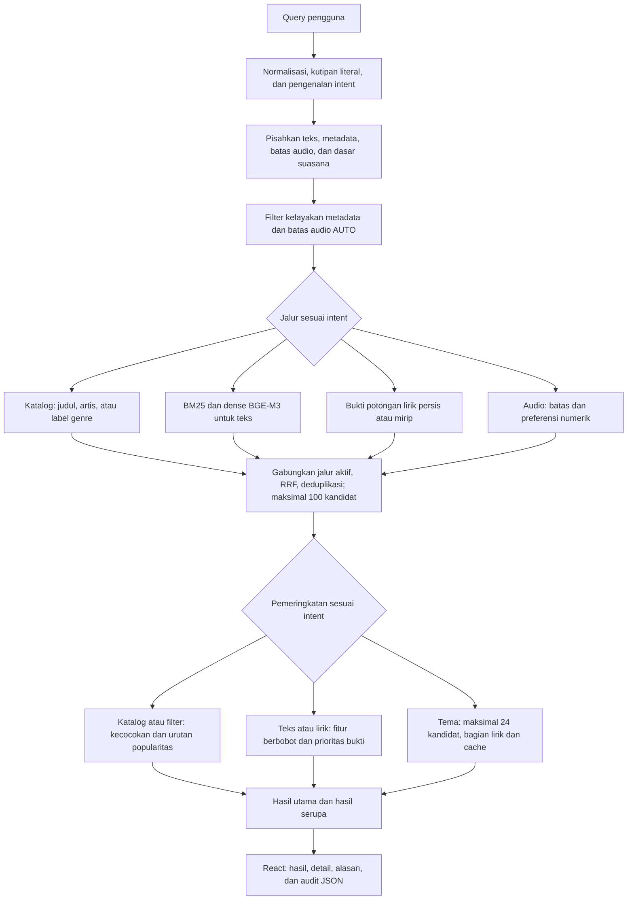

# Revisi Laporan Music IR Berdasarkan Implementasi Akhir

**Dokumen acuan:** `Laporan_UTS_TKI_Kelompok_4_Revisi (ril).docx`.<br>
**Dasar revisi:** kode, konfigurasi, corpus, dan pengujian Music IR yang tersedia pada **20 November 2026**.

Dokumen ini berisi peta perubahan laporan, teks pengganti untuk bagian awal, draf Bab 4, dan draf Bab 5. Bagian A merupakan petunjuk penyuntingan; bagian B–D menyediakan bahan yang dapat dipindahkan ke laporan dengan penyesuaian gaya sitasi dan penomoran. Bagian E memuat bukti serta lampiran pendukung. Dokumen Word sumber tidak diubah.

## A. Peta Perubahan Laporan

### A.1 Penyesuaian pokok

Laporan awal merupakan rancangan eksperimen komparatif. Proyek yang telah dibangun menghasilkan prototipe web dengan pipeline **AUTO berbasis intent**, konfigurasi pembanding E1–E5, dan fasilitas audit. Bukti yang tersedia saat ini terdiri atas audit data, pengujian perangkat lunak, pemeriksaan batas numerik, serta analisis kasus pencarian. Penilaian relevansi manusia dan eksperimen efektivitas skala penuh belum dilaksanakan.

Dengan demikian, fokus laporan akhir perlu diarahkan pada **perancangan, implementasi, validasi fungsional, dan pembahasan perilaku sistem**. Rancangan ablasi E1–E5 tetap dijelaskan sebagai fasilitas eksperimen yang telah diimplementasikan, tetapi hasil perbandingan nDCG, MRR, dan Recall tidak boleh diisi dengan skor contoh dari unit test atau diasumsikan sudah tersedia.

| Bagian laporan sumber | Tindakan | Isi yang perlu ditambahkan atau diperbaiki |
|---|---|---|
| Judul | Opsional | Judul lama masih dapat digunakan. Judul yang lebih mencerminkan cakupan akhir: **“Music IR: Sistem Temu Kembali Lagu Berbasis Intent dengan Hybrid Retrieval dan Pemeringkatan Bertahap”**. |
| Abstrak | Isi | Kolom abstrak pada dokumen sumber masih kosong. Masukkan hasil implementasi, ukuran corpus, validasi, dan batas kesimpulan. |
| 1.1 Latar Belakang | Tambah | Masalah perbedaan pencarian judul, artis, lirik, genre, tema, dan karakteristik audio; kemiripan teks belum menjamin kesesuaian musik. |
| 1.2 Rumusan Masalah, Tujuan, dan Kontribusi | Ganti fokus | Sesuaikan pertanyaan dengan prototipe dan bukti yang tersedia. Perbandingan efektivitas E1–E5 menjadi evaluasi lanjutan. |
| 1.3 Ruang Lingkup | Revisi | Jelaskan fitur audio dari CSV, genre dari label playlist, popularitas untuk pengurutan skor seri, dan pemutar Spotify embed. |
| 2.1 Retrieval dan Representasi | Revisi | BGE-M3 sudah digunakan; bedakan embedding dokumen gabungan dan embedding bagian lirik. Query asli disimpan, sementara query encoder dapat diperluas. |
| 2.2 Reranking dan Posisi Penelitian | Tambah | Penilaian bagian lirik, pembanding tema, dan aturan dukungan konteks adalah rancangan proyek; bukan implementasi cross-encoder atau LLM reranker. |
| Tabel 1 sintesis literatur | Sesuaikan | Kolom penerapan harus membedakan metode yang direalisasikan dan evaluasi relevansi yang belum dijalankan. |
| 3.1 Desain Penelitian | Ganti | Pengembangan iteratif, validasi fungsional, dan analisis trace menjadi kegiatan yang benar-benar dilaporkan. |
| 3.2 Dataset dan Pra-pemrosesan | Perbarui status | Statistik sumber tetap sesuai; tambahkan audit hasil penggabungan, hash, ketersediaan fitur, dan status pasangan lirik yang masih `unknown`. |
| 3.3 Arsitektur dan Gambar 1 | Ganti | Tiga jalur retrieval tidak selalu aktif bersamaan. Tambahkan routing intent, jalur metadata, filter sebelum retrieval AUTO, penilaian bagian lirik, dan pengelompokan hasil. |
| 3.3 Teknologi antarmuka | Ganti | Streamlit diganti **React, TypeScript, dan Vite**. Backend memakai FastAPI. Hasil audit yang dibahas menggunakan BM25 lokal. |
| 3.4 Query Processing | Perluas | Pengenalan katalog, toleransi judul, perlindungan kutipan, pencocokan lirik, ekspansi tema, serta pilihan dasar suasana. |
| 3.4 Retrieval dan Reranking | Perluas | Tambahkan aturan skor AUTO, passage reranking, cache, bonus lirik, serta pemisahan hasil utama dan serupa. |
| 3.4 Skor audio dan skor seri | Koreksi | Pada AUTO, filter murni menghasilkan indikator 1 dan urutan popularitas, lalu ID. Aturan E1–E5 tetap dijelaskan terpisah. |
| 3.5 Konfigurasi Eksperimen | Revisi | E1–E5 adalah konfigurasi ablasi; **AUTO adalah pipeline aplikasi akhir**. E5 tidak disebut identik dengan sistem aplikasi lengkap. |
| 3.6 Query dan Penilaian Relevansi | Koreksi status | Tersedia 160 draft, tetapi belum ada review dan label manusia. Rencana dua penilai dan kesepakatan anotasi belum menjadi hasil. |
| 3.7 Metrik dan Prosedur | Pisahkan | Uji fungsi dan observasi durasi yang sudah tersedia dipisahkan dari evaluasi relevansi, median/p95, dan bootstrap yang belum dilaksanakan. |
| 3.8 Reproduksibilitas dan Validitas | Perluas | Simpan konfigurasi, revisi model, hash implementasi, trace, kondisi cache, dan batas generalisasi kasus yang digunakan untuk pengembangan. |
| Bab 4 | Tambahkan | Implementasi, corpus, pengujian, studi kasus, audit skor, observasi waktu, dan keterbatasan. Gunakan draf bagian C. |
| Bab 5 | Tambahkan | Kesimpulan yang menjawab tujuan implementasi dan saran yang mengikuti keterbatasan. Gunakan draf bagian D. |
| Deklarasi dan kontribusi tim | Tinjau | Pertahankan sumber data secara jujur; sumber dan pencocokan lirik tidak dianggap telah terverifikasi. Rincian peran anggota perlu berdasarkan pekerjaan nyata. |

**Penempatan:** masukkan Bab 4 dan Bab 5 sesudah bagian 3.8, sebelum Deklarasi dan Daftar Pustaka. Ikuti format penomoran dokumen sumber, yaitu `4. HASIL DAN PEMBAHASAN` dan `5. KESIMPULAN`, atau ubah seluruh penomoran secara konsisten bila template meminta format BAB.

### A.2 Pernyataan yang perlu dihindari

| Pernyataan yang tidak didukung | Pengganti yang sesuai bukti |
|---|---|
| “Model memperoleh akurasi 100%.” | “Pemeriksaan fungsional pada kasus yang digunakan memenuhi assertion yang ditetapkan.” |
| “Skor 1 berarti lagu paling relevan secara semantik.” | “Pada pencarian katalog persis atau filter murni, skor 1 merupakan indikator memenuhi syarat.” |
| “160 query telah dinilai.” | “Tersedia 160 draft query; penilaian relevansi manusia belum dilaksanakan.” |
| “E5/AUTO terbukti mengungguli BM25 berdasarkan nDCG.” | “Konfigurasi pembanding telah tersedia, tetapi perbandingan efektivitas belum disimpulkan.” |
| “Bobot optimal diperoleh melalui tuning.” | “Bobot dan ambang masih konfigurasi awal; `tuned=false`.” |
| “Elasticsearch telah menjadi backend semua hasil.” | “Hasil kasus yang dibahas memakai backend lokal; adapter Elasticsearch tersedia.” |
| “Sistem mengenali emosi dari rekaman suara.” | “Sistem memperkirakan nuansa menggunakan fitur numerik audio yang tersedia pada CSV.” |
| “Genre lagu sudah dipastikan benar.” | “Penyaringan memakai label genre playlist dari dataset.” |
| “Lirik dari sumber daring telah diverifikasi seluruhnya.” | “Ketersediaan lirik dicatat; status kecocokan pasangan lagu–lirik masih `unknown`.” |
| “Sistem menggunakan Spotify Web API untuk pencarian.” | “Pencarian memakai corpus lokal; Spotify embed dipakai untuk membuka pemutaran lagu.” |

## B. Usulan Perubahan pada Bagian Awal Laporan

### B.1 Abstrak pengganti

Penelitian ini menghasilkan Music IR, prototipe web untuk mencari lagu melalui judul, artis, potongan lirik, genre, tema, dan karakteristik audio. Corpus operasional terdiri atas 1.686 baris yang digabungkan menjadi 1.437 lagu unik berdasarkan `track_id`; sebanyak 1.404 lagu memiliki lirik. Sistem menerapkan pipeline AUTO yang mengenali maksud query dan mengaktifkan komponen pencarian sesuai kebutuhan. Kecocokan katalog menggunakan metadata, sedangkan pencarian teks memadukan BM25, dense embedding BGE-M3, Reciprocal Rank Fusion, dan pemeringkatan berbasis fitur. Pencarian lirik memperoleh prioritas dari bukti frasa persis atau mirip, sementara pencarian tema menilai bagian lirik menggunakan encoder yang sama. Fitur numerik audio digunakan sebagai filter dan preferensi, termasuk perkiraan suasana berdasarkan valence dan energy. Antarmuka dibangun dengan React dan TypeScript, dengan layanan FastAPI serta fasilitas ekspor jejak keputusan. Validasi mencakup 93 pengujian backend, dengan 88 lulus dan lima integrasi Elasticsearch dilewati, 15 pengujian antarmuka yang lulus, serta sembilan pemeriksaan kasus melalui API. Studi kasus memperlihatkan penanganan kesalahan ingatan judul, pencarian lirik, penyaringan genre, dan pemisahan hasil utama dari hasil serupa. Evaluasi efektivitas berbasis qrels manusia belum dilakukan sehingga kesimpulan dibatasi pada implementasi, fungsi, dan perilaku kasus yang diperiksa.

**Kata kunci:** temu kembali musik; pencarian berbasis intent; BM25; BGE-M3; hybrid retrieval; pemeringkatan bertahap.

### B.2 Tambahan untuk 1.1 Latar Belakang

Perbedaan kebutuhan pencarian tidak cukup ditangani dengan satu fungsi skor untuk seluruh query. Permintaan nama artis membutuhkan kecocokan anggota kredit artis, sedangkan permintaan genre memerlukan atribut kategori yang sesuai. Kemunculan kata genre dalam judul belum membuktikan kesesuaian kategori musik. Demikian pula, lirik yang memuat kata kehilangan atau kebutuhan akan kasih sayang dapat memiliki kemiripan dengan query sedih, walaupun karakter musiknya ceria. Oleh karena itu, sistem perlu membedakan bukti metadata, bukti lirik, kemiripan tema, dan batas audio sebelum menentukan kandidat serta urutan hasil.

### B.3 Pengganti 1.2 Rumusan Masalah, Tujuan, dan Kontribusi

Rumusan masalah pada realisasi proyek adalah sebagai berikut.

1. Bagaimana mengintegrasikan pencarian metadata, leksikal, semantik, dan fitur numerik audio dalam satu pipeline yang memilih jalur menurut maksud query?
2. Bagaimana menangani kutipan lirik, kesalahan ingatan terbatas pada judul atau lirik, serta query tematik tanpa menyamakan seluruh bentuk kecocokan?
3. Bagaimana menerapkan batas audio dan membedakan hasil utama dari hasil serupa agar alasan pemilihan lagu dapat ditelusuri?
4. Bagaimana hasil validasi fungsional, analisis kasus, dan pengamatan biaya respons pada implementasi Music IR yang dibangun?

Tujuan penelitian adalah membangun dan memvalidasi prototipe Music IR pada corpus lagu pilihan tim. Kontribusi implementasi meliputi corpus satu dokumen per `track_id` disertai audit; pipeline AUTO berbasis intent; kombinasi retrieval dan pemeringkatan yang dapat ditelusuri; pemeriksaan bagian lirik dengan cache; penyaringan fitur audio; serta antarmuka web untuk pencarian dan pemeriksaan jejak keputusan. Konfigurasi E1–E5 dan fasilitas evaluasi disediakan sebagai dasar eksperimen komparatif lanjutan. Hasil saat ini tidak digunakan untuk menyatakan keunggulan statistik suatu konfigurasi.

**Catatan penyuntingan:** RQ komparatif lama dapat dipindahkan ke bagian saran atau rencana evaluasi lanjutan. Jika tetap dipertahankan dalam Bab 1, beri keterangan bahwa pertanyaan tersebut belum terjawab oleh hasil proyek yang tersedia.

### B.4 Pengganti 1.3 Ruang Lingkup

Objek pencarian adalah metadata, lirik, label playlist, dan fitur numerik yang telah tersedia dalam CSV. Proyek tidak melakukan pengenalan humming, fingerprint rekaman, pencocokan melodi, ataupun ekstraksi fitur dari berkas audio. BGE-M3 digunakan sebagai encoder pretrained tanpa pelatihan ulang. Pemahaman intent memakai pola dan aturan yang terbatas; sistem belum merupakan parser bahasa alami umum.

Label genre berasal dari kategori playlist. Popularitas dari CSV dipakai sebagai urutan tambahan ketika kecocokan katalog atau filter murni menghasilkan skor yang sama. Popularitas tersebut merupakan nilai pada snapshot dataset dan tidak mewakili tren Spotify terkini. Lagu tanpa lirik tetap dapat dicari melalui metadata atau atribut numeriknya.

Pemutaran disediakan melalui Spotify embed. Pencarian tidak membutuhkan integrasi Spotify Web API berautentikasi. Favorit dan playlist disimpan pada browser menggunakan `localStorage`; aplikasi belum menyediakan akun, sinkronisasi antarpengguna, atau rekomendasi personal yang dilatih.

### B.5 Perubahan untuk Bab 2

Landasan BM25 pada referensi [2], BGE-M3 pada [12], dan RRF pada [17] dapat dipertahankan. Penjelasan umum tidak perlu ditulis ulang menjadi klaim keunggulan Music IR. Tambahkan penjelasan berikut pada bagian representasi dan reranking.

> Pada implementasi Music IR, representasi dokumen gabungan digunakan untuk pengambilan kandidat, sedangkan representasi bagian lirik digunakan untuk memeriksa kandidat tematik. Keduanya memakai dense encoder BGE-M3 yang sama. Model tersebut mendukung masukan multibahasa dan teks panjang, tetapi dukungan model secara umum tidak menjamin relevansi seluruh hasil pada corpus musik ini. [Sumber model dan penelitian BGE-M3](https://aclanthology.org/2024.findings-acl.137/).
>
> RRF menggabungkan posisi pada daftar retrieval. Proyek menggunakan konstanta 60 dan membatasi jumlah kandidat sebelum pemeringkatan lanjutan. RRF dipakai untuk pembentukan kandidat dan, pada jalur tertentu, pemecahan skor seri. Kebijakan katalog/filter AUTO memiliki urutan tambahan berdasarkan popularitas dataset. [Sumber asli RRF](https://cormack.uwaterloo.ca/cormack/cormacksigir09-rrf.pdf).
>
> Pemeriksaan bagian lirik, deskripsi tema pembanding, bonus kecocokan frasa, dan aturan penanda perpisahan merupakan kebijakan implementasi proyek. Komponen tersebut tidak boleh disebut sebagai cross-encoder, learned-to-rank model, atau LLM reranker. Parameter yang digunakan masih memerlukan evaluasi relevansi terpisah.

Pada Tabel 1, ubah penerapan granularitas teks menjadi “embedding lagu untuk retrieval dan bagian lirik untuk pemeriksaan tema”. Ubah penerapan benchmark menjadi “infrastruktur draft, review, qrels, dan evaluator tersedia; anotasi serta evaluasi efektivitas belum dijalankan”.

### B.6 Pengganti 3.1 Desain Penelitian

Pengembangan dilakukan melalui audit corpus, implementasi retrieval dan layanan web, pengamatan kesalahan pada pencarian, perbaikan pipeline, dan pengujian regresi. Analisis perilaku menggunakan export JSON yang mencatat intent, sumber kandidat, filter, peringkat, kontribusi skor, serta identitas corpus dan implementasi. Kasus yang dipakai untuk pengembangan dijalankan kembali untuk memeriksa perubahan perilaku. Karena kasus tersebut turut memengaruhi rancangan aturan, hasilnya diperlakukan sebagai validasi pengembangan, bukan test set independen.

Konfigurasi E1–E5 tetap diimplementasikan untuk memungkinkan ablasi. Pipeline AUTO menjadi konfigurasi aplikasi akhir dan memiliki kebijakan tambahan yang tidak diterapkan pada E1–E5. Laporan hasil berfokus pada audit data, keberfungsian komponen, pemeriksaan kasus, dan observasi biaya komputasi. Pembandingan efektivitas berbasis penilaian relevansi manusia berada di luar hasil yang telah diperoleh.

### B.7 Perbaikan untuk 3.2 Dataset dan Pra-pemrosesan

Pertahankan statistik 1.686 baris, 30 kolom, 1.437 ID unik, dan 249 kemunculan tambahan. Tambahkan bahwa penggabungan dilakukan berdasarkan `track_id`, atribut playlist digabung sebagai himpunan nilai unik, dan atribut lain memakai nilai tidak kosong pertama. Pada audit saat ini tidak ditemukan konflik nilai antarrecord yang digabungkan. Seluruh 14 atribut numerik hasil pengolahan terisi dan dapat digunakan sebagai angka.

Teks sumber dipertahankan, sedangkan bentuk ternormalisasi memakai Unicode NFKC dan perapian spasi. Corpus disimpan sebagai JSON dan Parquet. Tidak diterapkan penghapusan lagu hanya karena judulnya sama; ID berbeda dapat menunjukkan rekaman atau versi berbeda. Status kecocokan seluruh pasangan lagu–lirik masih `unknown`, sehingga keberadaan lirik tidak disamakan dengan ketepatan pasangan.

**Koreksi terhadap redaksi sumber:** jangan menyebut dua lirik pendek dan seluruh sampel telah diperiksa manual apabila belum ada catatan pemeriksaannya. Gunakan “dua lirik pendek dicatat untuk audit lanjutan”.

### B.8 Pengganti 3.3 Arsitektur dan Alur Sistem

Antarmuka Music IR dibangun menggunakan React, TypeScript, dan Vite. FastAPI menyediakan layanan katalog, detail lagu, pencarian, dan pemeriksaan eksperimen. Pada lingkungan lokal, frontend mengakses `/api/*`, lalu proxy meneruskan request ke backend. Data pencarian, model, dan cache berada pada penyimpanan lokal proyek. Backend BM25 lokal digunakan pada kasus yang dilaporkan; adapter Elasticsearch tersedia untuk eksperimen lanjutan dan skornya tidak dinyatakan identik dengan implementasi lokal.

Pipeline AUTO dimulai dengan normalisasi dan pengenalan maksud query. Kutipan lirik dipertahankan sebagai isi literal. Kecocokan judul, artis, atau genre mengaktifkan jalur metadata, sedangkan query teks lain dapat mengaktifkan BM25, dense retrieval, dan bukti potongan lirik. Fitur audio diaktifkan jika terdapat batas, preferensi, atau kebijakan suasana yang dikenali. Pada AUTO, kelayakan metadata dan batas audio diperiksa sebelum pengambilan kandidat dari jalur yang relevan.

Penggabungan kandidat menggunakan RRF dan deduplikasi ID. Pemeringkatan berikutnya mengikuti intent: kecocokan katalog; fitur teks berbobot; prioritas bukti lirik; atau penilaian bagian lirik untuk tema. Hasil dikelompokkan sebagai hasil utama dan hasil serupa. Antarmuka meminta paling banyak 30 hasil gabungan. Batas API `top_k` berada pada 1–100 dengan default 10; batas tersebut merupakan maksimum, sehingga hasil dapat lebih sedikit. Pemeriksaan bagian lirik dibatasi pada 24 kandidat awal.

**Gambar pengganti untuk Gambar 1 — pipeline aplikasi AUTO:**



*Keterangan gambar:* jalur diaktifkan sesuai query; gambar tidak menyatakan bahwa semua jalur berjalan bersamaan. Diagram ini menjelaskan AUTO. E1–E5 tetap mengikuti konfigurasi ablasi masing-masing.

### B.9 Pengganti atau Tambahan untuk 3.4 Metode

#### B.9.1 Pengenalan intent dan kecocokan katalog

Pengenalan intent menggunakan aturan yang dapat diperiksa. Nama katalog yang persis cocok diprioritaskan, dengan kutipan atau awalan lirik dipertahankan sebagai permintaan literal. Kredit artis dicocokkan sebagai nama atau urutan kredit lengkap, termasuk kolaborasi dan nama yang mengandung koma. Ketiadaan ID artis per anggota membuat pemisahan tersebut tetap memiliki keterbatasan tekstual.

Toleransi judul multikata mensyaratkan similarity urutan token minimal 0,75, sedikitnya tiga kata yang sama, dan paling banyak satu edit kata. Sistem memilih kandidat dengan similarity tertinggi. Bukti lirik persis pada query tanpa awalan dapat mengalahkan dugaan judul yang hanya mirip; judul katalog persis tetap dikenali sebagai `title`. Query genre seperti `rock song` menggunakan atribut `playlist_genre`.

#### B.9.2 Retrieval leksikal dan semantik

Rumus BM25 dan cosine pada laporan awal dapat dipertahankan. Bobot field awal judul–artis–lirik adalah 3:2:1, dengan `k1=1.2` dan `b=0.75`. Implementasi lokal melakukan tokenisasi Unicode dan penyeragaman huruf; implementasi Elasticsearch menggunakan analyzer yang dikonfigurasi tersendiri. Keduanya perlu dibedakan ketika hasil eksperimen dilaporkan.

Representasi embedding dokumen adalah gabungan judul, artis, dan lirik. Vektor dokumen dinormalisasi dan dibandingkan dengan vektor query menggunakan cosine tepat terhadap seluruh corpus. Model yang dipakai adalah `BAAI/bge-m3` pada revisi `5617a9f61b028005a4858fdac845db406aefb181`. Proyek menggunakan keluaran dense berdimensi 1.024. Sparse dan multi-vector BGE-M3 belum digunakan. Rancangan pemotongan teks di atas 8.192 token tetap tersedia, tetapi metadata build saat ini menunjukkan tidak ada lagu yang memerlukannya.

Query asli disimpan pada respons. Query untuk encoder dapat berbeda setelah penghapusan pembungkus tema atau perluasan deskripsi yang dikenali. Contohnya, tema cinta diberi konteks kasih sayang dan relasi pasangan. Transformasi ini harus dijelaskan agar laporan tidak lagi menyatakan bahwa semua bentuk query encoder selalu identik dengan masukan pengguna.

#### B.9.3 Filter dan preferensi audio

Batas seperti `tempo > 120 BPM` diperlakukan sebagai filter keras. Preferensi seperti `tempo cepat` atau `energi rendah` memakai persentil empiris corpus. Persentil menggunakan mid-rank untuk nilai seri. Nilai yang tidak tersedia diberi skor lunak netral 0,5, sedangkan nilai yang hilang tidak lolos filter keras yang mensyaratkannya.

Jika hanya terdapat batas keras, seluruh kandidat yang lolos memperoleh indikator audio 1. Pada AUTO, sumber kandidat audio dengan skor konstan disusun menurut popularitas sebelum pemotongan kandidat, lalu ID untuk nilai yang masih seri. Query batas tempo tidak secara implisit meminta lagu tercepat atau yang paling dekat dengan ambang.

Pilihan suasana yang dikenali memiliki tiga dasar: `lyrics`, `audio`, dan `both`. Default aplikasi adalah `both`. Untuk suasana sedih/sendu, kebijakan awal menggunakan `valence <= 0.5` dan `energy <= 0.65`; suasana ceria menggunakan `valence >= 0.5`. Pilihan lirik tidak menambahkan batas suasana audio, sedangkan pilihan audio saja tidak menilai makna lirik. Batas numerik eksplisit tetap diiriskan dengan batas suasana. Nilai ambang ini merupakan heuristik, belum hasil kalibrasi penilaian emosi manusia.

#### B.9.4 Fusion dan reranking dasar

Untuk daftar aktif \(J(q)\), RRF dihitung sebagai:

$$
RRF(q,d)=\sum_{j\in J(q),\ d\in L_j}\frac{1}{60+rank_j(d)}.
$$

Dokumen yang tidak muncul pada suatu daftar tidak menerima kontribusi dari daftar tersebut. Kandidat dideduplikasi menurut ID dan dibatasi maksimal 100. Bukti lirik pada AUTO memperoleh reservasi kandidat dengan tetap memenuhi filter. Untuk teks biasa, urutan fitur adalah BM25 ternormalisasi, cosine ternormalisasi, overlap judul, overlap artis, dan kecocokan frasa. Bobot awalnya:

$$
\mathbf{w}=[0.25,\ 0.25,\ 0.25,\ 0.25,\ 0].
$$

BM25 dinormalisasi min–max pada kandidat; rentang nol menghasilkan nilai nol. Cosine dinormalisasi menggunakan \((cos+1)/2\). Overlap judul dan artis memakai nilai maksimum exact match dan Jaccard token. Bila semantik gagal pada query AUTO yang memerlukannya, komponen cosine dinonaktifkan, bobot yang tersisa dinormalisasi ulang, dan peringatan ditampilkan. E1–E5 tidak menggunakan fallback ini untuk query semantik eksperimen.

Skor teks dan audio dipadukan menurut:

$$
S(q,d)=(1-\lambda)T(q,d)+\lambda A(q,d)+B(q,d).
$$

Nilai awal \(\lambda=0.5\) dipakai untuk gabungan teks–audio, \(\lambda=0\) tanpa kebutuhan audio, dan \(\lambda=1\) untuk audio murni. Untuk kecocokan katalog, komponen teks menggunakan similarity metadata. Kebijakan tambahan tema dan lirik dijelaskan terpisah di bawah.

#### B.9.5 Pencocokan dan prioritas potongan lirik

Pencocokan lirik menggunakan normalisasi apostrof/Unicode dan ekspansi kontraksi, kemudian memeriksa urutan token pada lirik. Jika tidak terdapat kecocokan persis, query 4–32 token dengan sedikitnya tiga token unik dapat diperiksa menggunakan toleransi edit terbatas. Kandidat perlu didukung minimal 60% token unik query, dengan sedikitnya tiga token pendukung, dan paling banyak 200 kandidat diperiksa. Anggaran edit adalah satu token untuk query sampai enam token atau dua token untuk query yang lebih panjang. Typo satu karakter atau transposisi pada kata minimal empat karakter mendapat biaya substitusi 0,35. Ambang similarity keseluruhan adalah 0,76. Batas tersebut menghindari pemeriksaan edit terhadap seluruh corpus tanpa dukungan istilah yang memadai.

Bonus AUTO pada query lirik diberikan sebagai:

$$
B(q,d)=
\begin{cases}
4, & \text{frasa lirik cocok persis},\\
2\,sim_{edit}(q,d), & \text{frasa lirik memenuhi aturan kecocokan mirip},\\
0, & \text{lainnya}.
\end{cases}
$$

Similarity tersebut mengukur kecocokan teks, bukan probabilitas relevansi. Bonus tidak ditambahkan pada pencarian judul katalog, walaupun judulnya juga muncul dalam lirik. Hasil dengan bukti kutipan menjadi hasil utama; kandidat tanpa bukti ditempatkan sebagai hasil serupa. Skor dapat melebihi 1 karena adanya bonus eksplisit.

#### B.9.6 Penilaian bagian lirik untuk tema

Untuk query tema yang dikenali, paling banyak 24 kandidat awal diperiksa lebih lanjut. Lirik dibagi menjadi bagian 160 kata dengan overlap 40 kata. Bagian lirik dienkode menggunakan BGE-M3 yang sama dengan retrieval dokumen. Proses ini tidak menambah model baru atau melatih parameter encoder.

Pada tema umum, similarity bagian lirik dibandingkan langsung dengan query. Pada profil cinta dan sulit move on, sistem memakai deskripsi tema pembanding yang eksplisit. Profil cinta dibandingkan dengan konteks pesta atau pamer/kekerasan, sedangkan profil sulit move on dibandingkan dengan hubungan bahagia atau pencarian pasangan baru. Untuk bagian \(p\), sinyal pemeringkatannya adalah:

$$
r_p=
\begin{cases}
\cos(q,p), & \text{tanpa tema pembanding},\\
\frac{\cos(q,p)-\max_{n\in N_q}\cos(n,p)}{2}, & \text{dengan tema pembanding}.
\end{cases}
$$

Bagian diurutkan menurut \(r_p\). Sinyal bagian lirik suatu lagu menggabungkan nilai terbaik dan rerata paling banyak tiga bagian terbaik:

$$
R_P(d)=0.7r_{(1)}+0.3\operatorname{mean}(r_{(1)},\ldots,r_{(\min(3,m))}).
$$

Untuk kandidat dengan bukti bagian lirik, skor tema memakai:

$$
T_{tema}(q,d)=0.4\frac{\cos(q,d)+1}{2}+0.6\frac{R_P(d)+1}{2}.
$$

Nilai 0,4 disimpan pada `theme.document_weight`; parameter tersebut belum dituning. Pada profil sulit move on, hasil utama juga memerlukan penanda tekstual perpisahan/kehilangan dari aturan terbatas Indonesia, Inggris, Spanyol, atau Prancis. Kandidat yang tidak memenuhi dukungan tersebut, serta kandidat tanpa bukti lirik, dapat ditempatkan sebagai hasil serupa. Aturan ini membantu pemisahan kebutuhan spesifik, tetapi dapat melewatkan ungkapan metaforis atau bahasa lain.

Vektor bagian lirik disimpan pada cache SQLite. Kunci cache mencakup teks, identitas/revisi model, dan versi representasi. Pembuatan bagian baru terjadi pada pencarian pertama yang membutuhkannya; pencarian berikutnya dapat memakai ulang vektor. Kegagalan pemeriksaan bagian lirik memunculkan peringatan dan fallback ke embedding lagu.

#### B.9.7 Arti skor, urutan, dan penjelasan hasil

Skor antarjenis query tidak memiliki arti numerik yang seragam. Pada kecocokan katalog persis atau filter audio murni, nilai 1 berarti memenuhi syarat. Pada preferensi audio terdapat skor relatif atribut. Pada query teks/tema, skor berasal dari kontribusi retrieval dan reranking. Skor tersebut tidak diubah menjadi persentase keyakinan atau akurasi.

AUTO memecahkan skor seri katalog/filter murni menggunakan popularitas dataset dan ID. Jalur teks umum memakai skor, RRF, lalu ID. Respons menyertakan `ranking.score_kind`, `score_meaning`, dan `order_by`, sehingga pembaca audit mengetahui dasar pengurutan yang sebenarnya.

### B.10 Pengganti Tabel 3 pada 3.5

| ID | Konfigurasi yang tersedia | Kedudukan dalam laporan akhir |
|---|---|---|
| E1 | BM25 satu field gabungan | Baseline leksikal untuk eksperimen. |
| E2 | BM25 multi-field judul–artis–lirik | Pembanding konfigurasi field. |
| E3 | E2 + dense BGE-M3, RRF, maksimal 100 kandidat | Pembanding penambahan retrieval semantik. |
| E4 | Kandidat E3 yang sama, reranking teks berbobot | Pembanding pengurutan ulang pada kandidat yang sama. |
| E5 | Retrieval dan pemeringkatan teks–audio; filter numerik | Pembanding penambahan komponen audio. |
| AUTO | Routing intent, katalog, prioritas lirik, tema berbasis bagian lirik, filter sebelum retrieval, pengelompokan hasil, dan audit | Pipeline aplikasi yang digunakan pada hasil kasus Bab 4. |

E1–E5 merupakan konfigurasi komponen, bukan lima model semantik yang berbeda. E1/E2 sengaja tidak melakukan semantic search. Implementasi E3/E4 mempertahankan himpunan kandidat yang sama. E5 sama dengan E4 pada query tanpa intent audio, sedangkan AUTO memiliki aturan tambahan sehingga tidak dapat disamakan dengan E5. Perbandingan efektivitas konfigurasi belum menjadi hasil penelitian saat ini.

### B.11 Pengganti 3.6 Query dan Penilaian Relevansi

Tersedia 160 draft query dalam lima kategori, masing-masing 32 query. Pembagian rancangan terdiri atas 40 development dan 120 test, dengan kelompok query terkait ditempatkan pada split yang sama. Infrastruktur review definisi, pool kandidat, penilaian bertingkat 0–3, penyimpanan qrels, serta ekspor telah tersedia. Pada snapshot pelaporan, tabel review dan judgment manusia masing-masing masih berisi nol record.

Pengujian kasus memakai tujuh query yang diberikan pengguna, dilengkapi dua kasus penjaga untuk pencarian suasana sedih dan lirik dengan kesalahan ingatan. Kasus tersebut dipakai untuk memeriksa fungsi dan membandingkan trace pengembangan. Assertion yang digunakan menyatakan perilaku yang diharapkan, seperti kecocokan artis, batas numerik, atau bukti frasa. Assertion tersebut tidak diubah menjadi label relevansi manusia dan tidak dianggap mewakili seluruh kebutuhan pencarian.

Rancangan penilaian relevansi bertingkat dan pemeriksaan antarpenilai dapat dipertahankan sebagai prosedur evaluasi lanjutan. Klaim pelaksanaan penilaian, penyelesaian konflik, atau kesepakatan dua penilai harus dihapus dari bagian hasil sampai kegiatan tersebut benar-benar dilakukan.

### B.12 Pengganti 3.7 Metrik dan Prosedur Pengujian

Validasi yang dilaporkan mencakup pengujian backend dengan `unittest`, pengujian browser dengan Playwright, build frontend, dan pemeriksaan API terhadap sembilan kasus. Pemeriksaan meliputi intent, batas kandidat, pencocokan lirik, pemisahan kelompok hasil, filter audio, arti skor, serta konsistensi jumlah kontribusi terhadap skor numerik.

Durasi pencarian diamati dari trace dan skrip pemeriksaan. `latency_ms` engine tidak memasukkan pemuatan awal encoder, tetapi mencakup pembuatan embedding bagian lirik ketika cache belum tersedia. Pembentukan detail trace dilakukan setelah nilai latensi tersebut dicatat. Field `http_wall_seconds` pada skrip juga mencakup pengolahan respons dan pencatatan hasil di sisi klien, sehingga tidak diperlakukan sebagai latensi HTTP murni.

Rumus nDCG@10, MRR@10, dan Recall@100 pada laporan awal tetap dapat dijelaskan sebagai metrik yang didukung evaluator. Nilai pada corpus nyata belum dilaporkan karena qrels manusia belum tersedia. Prosedur lima pengulangan, warm-up terkontrol, median/p95, serta bootstrap pada rancangan awal dipindahkan ke rencana evaluasi lanjutan. Nilai contoh pada unit test metrik hanya memverifikasi fungsi perhitungan, bukan efektivitas Music IR.

Evaluator saat ini membaca daftar `results` sebagai ranking yang dinilai. Pada AUTO, daftar tersebut adalah kelompok utama dan tidak otomatis mencakup `related_results`. Sebelum melakukan pembandingan formal, tetapkan apakah objek penilaian adalah hasil utama, gabungan kelompok yang ditampilkan, atau cakupan kandidat. Pembatasan 24 kandidat tema AUTO dan 100 kandidat konfigurasi lain juga harus dinyatakan agar selisih Recall tidak keliru dianggap hanya sebagai pengaruh model.

### B.13 Pengganti atau Tambahan untuk 3.8

Reproduksibilitas dijaga dengan snapshot CSV, corpus JSON/Parquet, hash sumber dan corpus, konfigurasi, revisi encoder, hash implementasi, log pengujian, serta trace per query. Hasil sebelum dan sesudah perubahan disimpan terpisah. Pemeriksaan kasus Bab 4 memakai backend lokal dan konfigurasi awal dengan `tuned=false`.

Validitas temuan dibatasi oleh kualitas pasangan lagu–lirik yang belum diverifikasi menyeluruh, penggunaan label playlist sebagai proksi genre, aturan intent dan bahasa yang terbatas, ambang suasana yang belum dikalibrasi, serta pembatasan kandidat. Kasus yang digunakan untuk mengubah aturan juga menjadi bagian dari pemeriksaan regresi, sehingga keberhasilan pada kasus tersebut belum menunjukkan generalisasi terhadap query baru.

## C. Draf Bab 4 — Hasil dan Pembahasan

> Mulai bagian ini, judul dan paragraf dapat dipindahkan ke Bab 4 laporan. Sesuaikan nomor tabel/gambar dengan nomor terakhir pada dokumen Word. Referensi artefak dalam Markdown berfungsi sebagai sumber bukti; pada naskah akhir dapat ditempatkan sebagai lampiran atau tautan repositori.

## 4. HASIL DAN PEMBAHASAN

### 4.1 Lingkungan Implementasi dan Cakupan Hasil

Music IR telah diimplementasikan sebagai prototipe web lokal dengan frontend React, TypeScript, dan Vite serta backend FastAPI. Sistem menyediakan pencarian judul, artis, potongan lirik, label genre playlist, tema, dan atribut numerik audio. Pipeline AUTO menjadi pilihan default. E1–E5 tersedia untuk eksperimen, tetapi hasil pada bab ini berfokus pada realisasi aplikasi dan pemeriksaan kasus AUTO.

**Tabel 4.1. Lingkungan dan komponen implementasi.**

| Komponen | Kondisi yang diverifikasi |
|---|---|
| Sistem operasi | Windows 11; versi platform yang tercatat `10.0.26200`. |
| Python | 3.14.4 pada virtual environment proyek. |
| Frontend | React 19.3.1, TypeScript 7.0.2, Vite 8.3.8. |
| Node.js | 24.15.0. |
| API | FastAPI, dijalankan melalui Uvicorn. |
| Backend leksikal pada studi kasus | BM25 lokal. |
| Backend alternatif | Adapter Elasticsearch tersedia; lima pengujian integrasinya dilewati dalam validasi ini. |
| Encoder | BAAI/bge-m3, keluaran dense 1.024 dimensi, inferensi CPU. |
| Penyimpanan | Corpus JSON/Parquet, artefak embedding, dan cache SQLite bagian lirik. |
| Pengujian browser | Playwright 1.65.1 dengan Chrome. |

Rincian model CPU dan kapasitas RAM belum disimpan sebagai bagian dari pengukuran ini. Oleh karena itu, durasi yang diamati tidak digunakan untuk membandingkan kinerja perangkat keras atau mengklaim batas layanan produksi.

### 4.2 Hasil Audit dan Pembentukan Corpus

Pengolahan sumber menghasilkan satu dokumen untuk setiap `track_id`. Dari 1.686 baris sumber terdapat 1.437 ID lagu unik. Sebanyak 249 kemunculan tambahan berasal dari ID berulang dan digabungkan tanpa menghapus rekaman yang berbeda ID. Metadata playlist dipertahankan sebagai daftar sehingga keanggotaan kategori tetap dapat digunakan.

**Tabel 4.2. Ringkasan corpus hasil pengolahan.**

| Pemeriksaan | Hasil |
|---|---:|
| Baris sumber | 1.686 |
| Kolom sumber | 30 |
| Lagu unik | 1.437 |
| Kemunculan tambahan ID | 249 |
| Lagu dengan lirik | 1.404 |
| Cakupan ketersediaan lirik | 97,70% |
| Lagu tanpa lirik | 33 |
| Lirik kurang dari 100 karakter | 2 |
| Lagu dengan beberapa label genre playlist | 143 |
| Konflik nilai pada penggabungan | 0 |
| Atribut numerik yang seluruh nilainya terisi | 14 |

Angka 97,70% menunjukkan cakupan lirik, bukan akurasi pencocokan lirik dengan rekaman. Status pasangan lagu–lirik masih `unknown`. Dua lirik pendek dicatat sebagai kebutuhan audit lanjutan. Nilai numerik yang lengkap memungkinkan filter tempo, energy, valence, danceability, dan acousticness diperiksa tanpa mengganti nilai hilang pada corpus saat ini; perilaku atribut hilang tetap diuji melalui fixture.

Artefak embedding memiliki bentuk **1.437 × 1.024** dengan tipe `float32`. Metadata build menunjukkan tidak ada dokumen yang melampaui batas sehingga memerlukan pemotongan dokumen panjang. Catatan biaya persiapan embedding sebesar 3.267,37 detik, atau sekitar 54 menit 27 detik, berasal dari satu build pada CPU. Angka tersebut merupakan biaya persiapan yang tersimpan dan tidak digunakan sebagai latensi pencarian ataupun biaya pelatihan model.

### 4.3 Realisasi Antarmuka dan Layanan Pencarian

Antarmuka menyediakan kolom pencarian, daftar hasil, kartu hasil teratas, detail lirik dan audio, koleksi genre, favorit, serta playlist lokal. Hasil lirik terverifikasi ditampilkan pada kelompok kecocokan langsung. Kandidat yang hanya memiliki kemiripan kata atau makna ditempatkan pada kelompok hasil serupa. Pemisahan tersebut mencegah seluruh baris dipahami sebagai bukti kutipan yang sama kuat.

Pencarian metadata atau filter murni tidak membutuhkan pemuatan encoder. Ketika query teks memerlukan semantik tetapi encoder gagal, AUTO menyediakan peringatan dan fallback yang tercatat. Kondisi tersebut dapat dibedakan dari jalur yang memang tidak memerlukan semantik. Misalnya, pencarian genre dengan `semantic=false` tidak dianggap sebagai kegagalan model.

Panel jejak keputusan dapat menjalankan ulang query dengan konfigurasi yang sama dan memeriksa lagu target, termasuk lagu yang tersaring sebelum menjadi kandidat. JSON export menyimpan jenis query, jalur aktif, batas, sumber kandidat, urutan, kontribusi skor, serta identitas corpus dan kode. Favorit dan playlist tersimpan pada browser; fitur tersebut belum merupakan profil rekomendasi yang dilatih.


*Gambar 4.1. Contoh antarmuka pencarian tematik dengan hasil berdasarkan lirik. Gambar digunakan untuk memperlihatkan antarmuka; urutan kuantitatif mengacu pada trace versi pelaporan.*

### 4.4 Hasil Pengujian Fungsional

Pengujian ulang pada snapshot pelaporan memberikan hasil pada Tabel 4.3. Pengujian backend mencakup pengolahan data, parser, retrieval, routing metadata, lirik, suasana, cache, audit, dan evaluator. Pengujian browser memeriksa navigasi, pencarian, penyimpanan koleksi, pemilihan pemutar, pemisahan hasil, pengaturan suasana, tampilan audit, dan layout responsif.

**Tabel 4.3. Hasil validasi perangkat lunak.**

| Kelompok pemeriksaan | Hasil |
|---|---|
| Backend | 93 tes ditemukan; 88 lulus; 5 dilewati; tidak ada kegagalan. |
| Integrasi Elasticsearch | Lima tes dilewati; hasil ini tidak mengesahkan integrasi Elasticsearch pada pengujian tersebut. |
| Antarmuka Playwright | 15 tes lulus; tidak ada kegagalan. |
| Build frontend | Pemeriksaan TypeScript dan build Vite berhasil. |
| Pemeriksaan kasus melalui API | Sembilan kasus memenuhi assertion fungsional. |
| Audit tambahan tempo dan genre | Filter terpenuhi, skor indikator dijelaskan, dan urutan popularitas sesuai kebijakan. |

Keberhasilan pengujian menunjukkan bahwa perilaku yang didefinisikan pada skenario pemeriksaan berjalan sesuai harapan. Angka tersebut tidak dihitung sebagai akurasi relevansi seluruh corpus. Satu pengujian dapat memeriksa beberapa assertion, dan kasus yang diperiksa belum mewakili seluruh variasi kebutuhan pengguna.

### 4.5 Analisis Kasus Judul, Artis, Genre, dan Lirik

Tujuh export pengguna dijadikan dasar pengamatan kesalahan dan pengujian ulang. Dua kasus tambahan digunakan untuk menjaga perilaku suasana sedih dan lirik yang salah diingat. Ringkasan hasil terbaru disajikan pada Tabel 4.4. Jumlah utama dan serupa menggunakan batas antarmuka 30 hasil gabungan; pemeriksaan tema dibatasi 24 kandidat.

**Tabel 4.4. Ringkasan studi kasus pada implementasi akhir.**

| Query | Perilaku sebelum perbaikan yang tercatat | Perilaku versi pelaporan | Utama / serupa |
|---|---|---|---:|
| `bruno mars` | Sembilan lagu Bruno Mars diikuti lagu artis lain untuk mengisi 30 baris. | Intent `artist`; hanya sembilan lagu yang melibatkan Bruno Mars. | 9 / 0 |
| `locked out in heaven` | Target sudah pertama, tetapi disertai banyak hasil dari kata umum. | Intent `title`; target Locked out of Heaven ditemukan dengan toleransi satu kata. | 1 / 0 |
| `lagu bermakna cinta` | Bent dan Feel This Moment muncul pada lima teratas. | Penilaian tema berbasis bagian lirik; lima teratas menjadi Love Story, Born To Love Ya, ily (i love you baby), Do For Love, dan Supernova Love. | 24 / 0 |
| `rock song` | Didominasi kata rock/song pada judul; hanya 2 dari 10 teratas berlabel rock. | Intent `genre`; seluruh 30 hasil memenuhi label rock dari dataset. | 30 / 0 |
| `lagu tentang sulit melupakan seseorang` | Unforgettable berada pada urutan ketiga bersama tema relasi yang luas. | Be Alright menjadi hasil utama pertama; Unforgettable ditempatkan pada hasil serupa karena dukungan konteks perpisahan belum memenuhi aturan. | 12 / 12 |
| `not like us` | Target pertama, tetapi query diklasifikasikan sebagai lirik. | Intent `title`; Not Like Us menjadi kecocokan judul langsung. | 1 / 0 |
| `when i see your face` | Target pertama dengan bonus bukti lirik, tetapi kandidat lain berada pada satu daftar hasil. | Just the Way You Are menjadi hasil utama dengan bukti lirik persis; kandidat lain dipisahkan. | 1 / 29 |
| `lagu bermakna sedih` | Pada pengamatan awal, Sugar muncul tinggi walaupun nuansa musiknya tidak sesuai kebutuhan pengguna. | Default makna + musik; kandidat memenuhi valence dan energy. Tiga teratas versi pelaporan: THE LONELIEST, Sacrifice, dan Beanie. | 24 / 0 |
| `lirik "make the stars look like there not shining"` | Kasus kesalahan ingatan sebelumnya mengutamakan lagu lain. | Just the Way You Are menjadi hasil utama dengan kecocokan mirip. | 1 / 29 |

Perbaikan artis menghilangkan kontaminasi nama parsial seperti Bruno Martini. Penentuan urutan antarlagu yang sama-sama cocok memakai popularitas dataset, sehingga pencarian artis tidak perlu bergantung pada kemiripan embedding nama terhadap isi lirik.

Pada pencarian genre, perubahan utama adalah pengenalan kategori, bukan perubahan besar bobot judul. Hasil 30 dari 30 memenuhi label rock merupakan pemeriksaan konsistensi terhadap atribut dataset. Hasil tersebut belum membuktikan bahwa seluruh rekaman telah diklasifikasikan oleh penilai musik sebagai rock.

Pencarian `when i see your face` memperlihatkan perbedaan kekuatan bukti. Just the Way You Are berada pada posisi 68 dalam daftar leksikal dan 25 dalam daftar semantik. Jalur lirik menempatkannya pertama dengan bukti frasa persis. Kontribusi bonus sebesar 4 menghasilkan skor akhir sekitar 4,2356. Angka di atas 1 dapat dijelaskan oleh penjumlahan komponen dan tidak ditafsirkan sebagai probabilitas.

Pada query lirik yang salah diingat, similarity edit sebesar **0,7778** memenuhi ambang 0,76. Bonus yang dicatat adalah **1,5556**, sesuai aturan dua kali similarity. Skor akhir sekitar **1,9397** dan target tetap menjadi hasil utama pertama. Perilaku ini berasal dari pencocokan jendela token serta normalisasi kontraksi, tanpa daftar pengecualian lagu tertentu.

### 4.6 Pembahasan Pencarian Tema dan Bagian Lirik

Query cinta dan sulit melupakan memperlihatkan bahwa kemiripan embedding dokumen secara keseluruhan dapat menggabungkan kebutuhan yang berbeda. Tema romantis dapat bercampur dengan pesta atau ketertarikan fisik; seseorang yang dikenang secara positif belum tentu merupakan konteks kesulitan melanjutkan hidup setelah perpisahan.

Penilaian bagian lirik menyediakan unit teks yang dapat diperiksa. Deskripsi pembanding menambahkan pembeda konteks pada profil yang dikenali. Hasil tema cinta berubah menjadi daftar yang lebih berfokus pada relasi dan afeksi pada contoh yang diperiksa. Perubahan daftar tersebut merupakan hasil observasi kasus, bukan bukti statistik bahwa seluruh pencarian cinta sudah lebih relevan.

Untuk profil sulit move on, aturan penanda perpisahan membantu memisahkan kandidat yang hanya berkaitan dengan ingatan atau hubungan secara umum. Hasil utama pertama menjadi Be Alright, diikuti Far Behind dan Baby Can I Hold You. Unforgettable tetap dapat ditemukan pada hasil serupa. Pemisahan ini mempertahankan keterjangkauan kandidat sambil memperlihatkan keterbatasan dukungan terhadap rincian kebutuhan query.

Pendekatan tersebut masih memiliki risiko: ungkapan metaforis dapat tidak memuat penanda yang dikenali, bahasa selain cakupan aturan dapat terlewat, dan kemiripan bagian lirik tidak selalu menangkap sudut pandang keseluruhan lagu. Selain itu, hanya kandidat awal yang diperiksa; lagu yang terlewat pada retrieval tidak dapat diperbaiki oleh tahap ini.

### 4.7 Pembahasan Suasana Lirik dan Musik

Kebutuhan pengguna pada query sedih mencakup makna lirik dan nuansa musik sendu. Karena kedua aspek tersebut dapat berbeda, aplikasi menyediakan pilihan makna lirik, nuansa musik, dan keduanya. Default keduanya menggabungkan pengurutan makna dengan filter audio awal.

**Tabel 4.5. Pemeriksaan Sugar pada query sedih dengan dasar keduanya.**

| Atribut Sugar — Maroon 5 | Nilai dataset | Batas kebijakan | Keputusan |
|---|---:|---:|---|
| Valence | 0,884 | ≤ 0,5 | Tidak memenuhi. |
| Energy | 0,788 | ≤ 0,65 | Tidak memenuhi. |

Trace menandai Sugar sebagai `audio_filtered`, dengan kedua batas gagal tercatat. Lagu tersebut tidak dilarang secara global dan tetap dapat ditemukan melalui pencarian judul. Filter menghilangkan kandidat karena atributnya tidak sesuai kebijakan query, bukan karena identitas lagunya dimasukkan ke daftar pengecualian.

Valence dan energy merupakan proksi numerik untuk nuansa, bukan penentu makna lirik atau pengenal emosi yang pasti. Ambang awal dapat membuang lagu sedih yang berenergi tinggi, serta masih memungkinkan kandidat yang maknanya kurang sesuai. Kebijakan tersebut perlu dibaca sebagai pembatas kebutuhan sendu yang dipilih pengguna dan masih membutuhkan evaluasi relevansi terpisah.

### 4.8 Audit Skor dan Pengurutan Hasil

Dua kasus tambahan menampilkan skor 1 pada seluruh kandidat: filter `tempo > 120 BPM` dan pencarian `rock song`. Pemeriksaan kode dan trace menunjukkan bahwa skor tersebut berasal dari kelayakan syarat, bukan cosine semantik.

**Tabel 4.6. Arti skor pada dua kasus audit.**

| Query | Jumlah lagu memenuhi syarat sebelum batas kandidat | Arti skor 1 | Dasar urutan AUTO |
|---|---:|---|---|
| `tempo > 120 BPM` | 730 | Nilai tempo melewati batas. | Popularitas menurun, lalu ID untuk nilai seri. |
| `rock song` | 212 | Memiliki label genre playlist rock. | Popularitas menurun, lalu ID untuk nilai seri. |

Pada query tempo, seluruh lagu di atas 120 BPM memenuhi batas yang sama. Pengguna belum meminta lagu tercepat maupun yang paling dekat dengan 120 BPM. Oleh karena itu, variasi skor tidak dibuat hanya untuk membedakan baris. Query preferensi seperti `tempo cepat` memiliki fungsi yang berbeda dan dapat menghasilkan variasi skor persentil.

Audit menemukan bahwa versi sebelumnya memilih kandidat filter murni menurut ID saat skor sama. Urutan tersebut deterministik, tetapi tidak memberikan prioritas yang berguna dari atribut koleksi. Perbaikan menerapkan urutan popularitas sebelum batas 100 kandidat, sehingga lagu dengan ID lebih besar tidak tersisih hanya karena ID. Pada contoh, tiga hasil teratas berubah dari Sk8er Boi, Love Sosa, dan Sideways menjadi Die With A Smile, APT., dan WILDFLOWER, dengan seluruh hasil tetap memenuhi batas tempo.

Panel audit kini menampilkan “Memenuhi syarat”, nilai indikator, popularitas, serta penjelasan `order_by`. Skor numerik 1 dipertahankan pada JSON. Popularitas berfungsi sebagai kebijakan urutan koleksi, bukan ukuran relevansi semantik, kualitas musik, atau tingkat keyakinan model.


*Gambar 4.2. Audit query tempo yang menampilkan arti indikator dan dasar pengurutan.*

### 4.9 Observasi Waktu Respons dan Cache

Tabel 4.7 menyajikan observasi satu eksekusi per kasus pada versi pelaporan. Durasi engine dan durasi skrip dicatat terpisah karena batas pengukurannya berbeda. Pengamatan ini tidak memakai pengulangan acak terkontrol dan tidak merupakan median, p95, atau pembandingan antarkonfigurasi.

**Tabel 4.7. Observasi durasi pada beberapa kasus.**

| Query/kondisi | Durasi engine `latency_ms` | Durasi skrip, detik | Keterangan |
|---|---:|---:|---|
| `bruno mars` | 13,07 | 0,142 | Jalur metadata; encoder tidak dipakai. |
| `locked out in heaven` | 992,67 | 1,088 | Toleransi judul dan pemeriksaan bukti lirik. |
| `lagu bermakna cinta` | 667,73 | 17,071 | Cache bagian lirik tersedia; pemuatan awal model sekitar 16,25 detik dicatat terpisah dari engine latency. |
| `rock song` | 35,90 | 0,177 | Jalur metadata genre. |
| `lagu tentang sulit melupakan seseorang` | 748,27 | 0,882 | Cache bagian lirik tersedia. |
| `when i see your face` | 287,70 | 0,435 | Bukti lirik persis. |
| `lagu bermakna sedih`, cache belum lengkap | 37.606,82 | 37,744 | Membuat 49 vektor bagian baru; 13 vektor unik sudah tersedia. |

Pada pengulangan query sedih yang sama, durasi engine tercatat **662,48 ms**. Tidak ada bagian baru yang dienkode, dan 62 vektor unik digunakan ulang untuk 64 kemunculan bagian. Urutan ID hasil utama tetap sama. Perbedaan jumlah kemunculan dan vektor unik terjadi karena isi bagian yang sama dapat memakai cache yang sama.

Temuan tersebut menunjukkan bahwa biaya pembuatan cache perlu dicatat sebagai bagian pengalaman pencarian pertama. Kondisi awal model, cache, dan beban proses lain dapat memengaruhi durasi. Oleh karena itu, pasangan pengamatan ini tidak digunakan untuk menyatakan rasio percepatan umum. Pengukuran kinerja formal memerlukan perangkat keras lengkap, beban terkontrol, pengulangan, dan pelaporan distribusi waktu.

### 4.10 Kedudukan Evaluasi dan Keterbatasan

Fasilitas evaluasi telah menyediakan 160 draft query, penyimpanan review, qrels bertingkat, serta perhitungan nDCG@10, MRR@10, Recall@100, dan cakupan judgment. Namun, belum terdapat review atau judgment manusia dalam penyimpanan yang diperiksa. Karena itu, bab ini tidak melaporkan nilai efektivitas retrieval atau keunggulan E1–E5/AUTO.

**Tabel 4.8. Status bukti hasil.**

| Aspek | Status dan makna |
|---|---|
| Audit corpus | Tersedia; memverifikasi struktur dan kelengkapan data hasil pengolahan. |
| Validasi backend/UI | Tersedia; memverifikasi fungsi pada skenario yang didefinisikan. |
| Analisis kasus | Tersedia; menjelaskan perilaku dan perubahan pada contoh pengembangan. |
| Kepatuhan filter kasus tempo/genre/suasana | Tersedia pada kasus yang diperiksa; bukan akurasi tema. |
| Penilaian relevansi manusia | Belum tersedia. |
| nDCG@10, MRR@10, Recall@100 pada corpus nyata | Belum dilaporkan. |
| Tuning parameter pada development set berlabel | Belum dilakukan; `tuned=false`. |
| Median/p95 terkontrol, uji beban, dan bootstrap | Belum dilaksanakan sebagai hasil yang dilaporkan. |
| Validasi pasangan lirik secara menyeluruh | Belum dilakukan. |

Keterbatasan utama terdiri atas cakupan aturan intent, ketepatan label playlist, kecocokan pasangan lirik, subjektivitas tema, serta batas 100 kandidat dan 24 kandidat pemeriksaan bagian lirik. Ketergantungan pada cache juga menimbulkan biaya awal untuk query baru. Kasus yang digunakan dalam perbaikan belum menjadi sampel uji independen. Hasil mendukung kesimpulan implementasi dan validasi pengembangan; generalisasi efektivitas memerlukan data penilaian serta query baru yang terpisah.

## D. Draf Bab 5 — Kesimpulan

## 5. KESIMPULAN

### 5.1 Kesimpulan

Penelitian ini menghasilkan prototipe web Music IR yang mengintegrasikan pencarian metadata, leksikal, semantik, dan fitur numerik audio melalui pipeline AUTO berbasis intent. Corpus operasional berhasil disusun menjadi 1.437 dokumen lagu unik dari 1.686 baris sumber, dengan audit penggabungan dan ketersediaan lirik. Arsitektur memisahkan antarmuka React dari layanan FastAPI serta mempertahankan konfigurasi E1–E5 untuk eksperimen lanjutan.

Pengenalan intent memungkinkan kebutuhan katalog ditangani melalui kecocokan metadata, sementara query teks dapat memakai BM25, dense BGE-M3, RRF, serta pemeringkatan sesuai jenis bukti. Prioritas potongan lirik membantu mengembalikan target pada contoh lirik persis maupun salah diingat. Penilaian bagian lirik dan aturan konteks menyediakan dasar pemisahan hasil utama dari hasil serupa pada tema yang diperiksa. Seluruh proses menggunakan encoder pretrained yang sama tanpa pelatihan ulang.

Penerapan filter audio dan pilihan dasar suasana memperjelas perbedaan antara makna lirik dan karakter musik. Pada kasus sedih dengan kebutuhan musik sendu, Sugar tersaring berdasarkan valence dan energy yang melewati batas kebijakan. Audit skor juga memperjelas bahwa nilai 1 pada kecocokan katalog atau filter murni merupakan indikator memenuhi syarat; urutan skor seri AUTO ditentukan menggunakan popularitas dataset dan ID.

Validasi menghasilkan 88 tes backend lulus dari 93 tes yang ditemukan, dengan lima integrasi Elasticsearch dilewati, serta 15 tes antarmuka yang lulus. Build frontend berhasil dan sembilan pemeriksaan kasus API memenuhi assertion. Hasil tersebut menunjukkan bahwa fungsi yang diuji berjalan sesuai rancangan dan dapat ditelusuri melalui trace. Pengamatan waktu juga memperlihatkan biaya awal pembuatan cache bagian lirik yang perlu dipertimbangkan pada penggunaan aplikasi.

Belum tersedia qrels manusia untuk menyimpulkan efektivitas keseluruhan atau keunggulan statistik konfigurasi retrieval. Dengan demikian, kontribusi yang telah dibuktikan berada pada realisasi sistem, konsistensi fungsi, transparansi keputusan, dan perbaikan perilaku pada kasus pengembangan yang diperiksa. Ketepatan tema pada query baru, kalibrasi suasana, dan kinerja pada beban terkontrol masih menjadi kebutuhan evaluasi berikutnya.

### 5.2 Saran Pengembangan

1. Evaluasi query baru yang tidak digunakan untuk menyusun aturan, disertai penilaian relevansi manusia sebelum melakukan tuning atau menyatakan keunggulan metode.
2. Audit pasangan lagu–lirik, lirik pendek, label genre playlist, dan pemisahan kredit artis agar kualitas metadata tidak membatasi hasil retrieval.
3. Uji cakupan kandidat serta aturan konteks pada bahasa dan ungkapan metaforis lain. Kandidat yang belum memiliki dukungan cukup tetap perlu dapat ditemukan sebagai hasil serupa.
4. Kurangi biaya pencarian tema pertama melalui persiapan cache yang terencana, lalu ukur latensi dengan kondisi perangkat, model, cache, dan beban yang terdokumentasi.
5. Lakukan kalibrasi ambang suasana terhadap kebutuhan pengguna. Perubahan model atau fine-tuning dipertimbangkan setelah analisis kesalahan dan data berlabel menunjukkan kebutuhan yang jelas.

## E. Bukti, Lampiran, dan Pemeriksaan Sebelum Finalisasi

### E.1 Sumber bukti proyek

| Bukti | Lokasi | Kegunaan |
|---|---|---|
| Dokumen sumber yang diekstrak | [source-document.json](../artifacts/report-review/source-document.json) | Menelusuri struktur dan pernyataan laporan awal. |
| Audit corpus | [audit.json](../data/processed/audit.json) | Jumlah data, hash, konflik, dan kebijakan penggabungan. |
| Konfigurasi aktif | [config.json](../config.json) | Parameter awal, batas kandidat, ambang suasana, dan status tuning. |
| Metadata embedding | [metadata.json](../artifacts/semantic/metadata.json) | Revisi model, identitas corpus, dan catatan build CPU. |
| Ringkasan kasus versi pelaporan | [summary.json](../artifacts/report-review/final-search-cases/summary.json) | Tabel studi kasus dan durasi skrip terbaru. |
| Trace per kasus | [case-1.json](../artifacts/report-review/final-search-cases/case-1.json) sampai [case-9.json](../artifacts/report-review/final-search-cases/case-9.json) | Kontribusi, urutan kandidat, filter, dan identitas implementasi. |
| Cache dan pemeriksaan Sugar | [cache-comparison.json](../artifacts/report-review/final-search-cases/cache-comparison.json) | Perbandingan satu eksekusi cache belum lengkap dan sudah tersedia; alasan Sugar tersaring. |
| Trace pengulangan query sedih | [case-8-warm.json](../artifacts/report-review/final-search-cases/case-8-warm.json) | Detail query yang sama setelah cache tersedia. |
| Audit skor tempo/genre | [score-audit/summary.json](../artifacts/diagnostics/score-audit/summary.json) | Perubahan urutan default dan arti skor indikator. |
| Ringkasan verifikasi | [verification-summary.json](../artifacts/report-review/verification-summary.json) | Jumlah tes dan status build yang digunakan dalam laporan. |
| Log backend | [backend-tests.log](../artifacts/report-review/backend-tests.log) | Hasil `unittest` terbaru. |
| Log UI | [ui-tests.log](../artifacts/report-review/ui-tests.log) | Hasil 15 tes Playwright. |
| Log build | [frontend-build.log](../artifacts/report-review/frontend-build.log) | Bukti pemeriksaan TypeScript dan build Vite. |
| Implementasi pipeline | [engine.py](../music_ir/engine.py), [query.py](../music_ir/query.py), [metadata.py](../music_ir/metadata.py) | Routing, retrieval, pemeringkatan, dan metadata. |
| Implementasi lirik/tema/audio | [lyrics.py](../music_ir/lyrics.py), [passages.py](../music_ir/passages.py), [audio.py](../music_ir/audio.py), [mood.py](../music_ir/mood.py) | Penjelasan metode yang sesuai kode. |
| Audit dan evaluator | [diagnostics.py](../music_ir/diagnostics.py), [evaluate.py](../music_ir/evaluate.py) | Arti skor, jejak, serta metrik yang tersedia. |

`artifacts/` dan `data/processed/` merupakan berkas lokal yang diabaikan version control. Jika laporan diserahkan melalui repositori atau komputer lain, salin bukti yang diperlukan ke lampiran pengumpulan sesuai hak penggunaan datanya; tautan lokal saja belum cukup sebagai lampiran yang dapat diakses pembaca.

### E.2 Identitas snapshot untuk lampiran reproduksibilitas

```text
Tanggal pelaporan: 20 November 2026
Backend studi kasus: local
Status tuning: false
Model: BAAI/bge-m3
Revisi model: 5617a9f61b028005a4858fdac845db406aefb181
SHA-256 sumber CSV:
67d82c39457bc00a38ea384e5a330404e1d39714ccb06fe19d1facf8963d54e1
SHA-256 corpus:
2708d05f6486650d00bec7db689c2672b61829952f8a9b22ec2c3c9755402758
SHA-256 implementasi pada trace kasus versi pelaporan:
1dc18ed5bf735e4ff33917d7492b57c7c71f18006f80480f6e9663c54e01578b
```

Identitas tersebut merujuk snapshot implementasi yang diperiksa. Jika kode, corpus, atau konfigurasi berubah, jalankan ulang pemeriksaan dan perbarui tabel hasil; hasil lama tidak otomatis mewakili versi baru.

### E.3 Gambar tambahan yang dapat dipilih

| Materi gambar | Berkas | Penempatan yang disarankan |
|---|---|---|
| Pipeline AUTO | Diagram Mermaid pada B.8 | Bagian 3.3 sebagai pengganti Gambar 1 lama. |
| Pencarian artis | [intent-artist-desktop.png](../artifacts/ui/intent-artist-desktop.png) | Bagian 4.5 untuk memperlihatkan sembilan hasil. |
| Pencarian genre | [intent-genre-desktop.png](../artifacts/ui/intent-genre-desktop.png) | Bagian 4.5 untuk menjelaskan kategori playlist. |
| Lirik dan tampilan mobile | [intent-lyrics-mobile.png](../artifacts/ui/intent-lyrics-mobile.png) | Bagian 4.3 atau lampiran antarmuka. |
| Hasil tematik | [intent-theme-desktop.png](../artifacts/ui/intent-theme-desktop.png) | Bagian 4.3/4.6. |
| Arti skor filter | [score-policy-tempo-desktop.png](../artifacts/ui/score-policy-tempo-desktop.png) | Bagian 4.8. |

Pilih gambar yang menjelaskan temuan; tidak semua gambar harus masuk badan laporan. Caption perlu menyebut fungsi yang terlihat, sedangkan klaim angka dan urutan tetap merujuk trace yang disimpan.

### E.4 Rujukan dan integritas sitasi

Nomor [2], [12], dan [17] mengikuti daftar pustaka laporan sumber. Pertahankan penomoran jika daftar pustaka tidak berubah. Rujukan yang relevan dapat ditautkan sebagai berikut.

- Robertson dan Zaragoza, *The Probabilistic Relevance Framework: BM25 and Beyond* (2009), [DOI 10.1561/1500000019](https://doi.org/10.1561/1500000019). Dipertahankan dari daftar pustaka sumber; rumus operasional laporan ini juga ditelusuri dari implementasi lokal.
- Chen dkk., *M3-Embedding: Multi-Linguality, Multi-Functionality, Multi-Granularity Text Embeddings Through Self-Knowledge Distillation* (2024), [ACL Anthology](https://aclanthology.org/2024.findings-acl.137/). Untuk identitas model, tersedia [model card resmi BAAI/bge-m3](https://huggingface.co/BAAI/bge-m3).
- Cormack, Clarke, dan Büttcher, *Reciprocal Rank Fusion outperforms Condorcet and individual Rank Learning Methods* (2009), [salinan pada situs penulis](https://cormack.uwaterloo.ca/cormack/cormacksigir09-rrf.pdf).

Deskripsi tema pembanding, ambang suasana, bonus lirik, dan aturan dukungan konteks harus diatribusikan sebagai rancangan implementasi Music IR. Hasil pengujian penelitian lain tidak dipindahkan menjadi hasil Music IR. Daftar pustaka lama selain rujukan yang digunakan tetap perlu diperiksa relevansinya terhadap naskah akhir.

### E.5 Checklist akhir penyuntingan

- [ ] Isi abstrak dan sesuaikan kata kunci.
- [ ] Selaraskan rumusan masalah dengan hasil implementasi dan batas evaluasi yang tersedia.
- [ ] Ganti Streamlit dengan React/TypeScript/Vite; jelaskan backend lokal dan adapter Elasticsearch.
- [ ] Ganti Gambar 1 dengan pipeline AUTO yang memilih jalur menurut intent.
- [ ] Bedakan E1–E5 dari AUTO pada teks, tabel, dan kesimpulan.
- [ ] Perbarui batas hasil: default API/CLI 10, permintaan UI 30, kandidat umum 100, dan pemeriksaan tema 24.
- [ ] Tambahkan metode metadata, bukti lirik, bagian lirik, pembanding tema, cache, dan kebijakan suasana.
- [ ] Jelaskan skor indikator dan aturan urutan popularitas pada AUTO.
- [ ] Ganti klaim pelaksanaan anotasi/tuning dengan status yang benar-benar tersedia.
- [ ] Masukkan Bab 4 dan Bab 5 sebelum Deklarasi/Daftar Pustaka.
- [ ] Nomori ulang gambar, tabel, dan persamaan secara konsisten; salin rumus ke editor persamaan Word bila diperlukan.
- [ ] Lampirkan bukti yang dapat diakses pembaca, bukan hanya path lokal.
- [ ] Jangan menyebut hasil kasus atau tes perangkat lunak sebagai akurasi keseluruhan.
- [ ] Lengkapi catatan sumber data dan kontribusi anggota berdasarkan informasi yang dapat diverifikasi.
